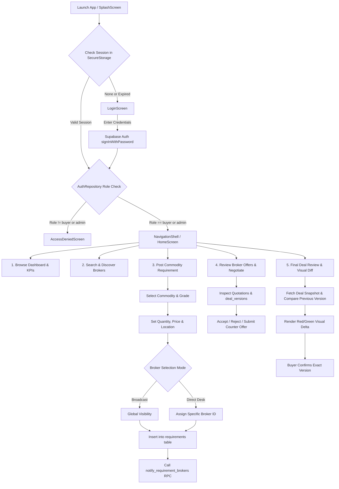
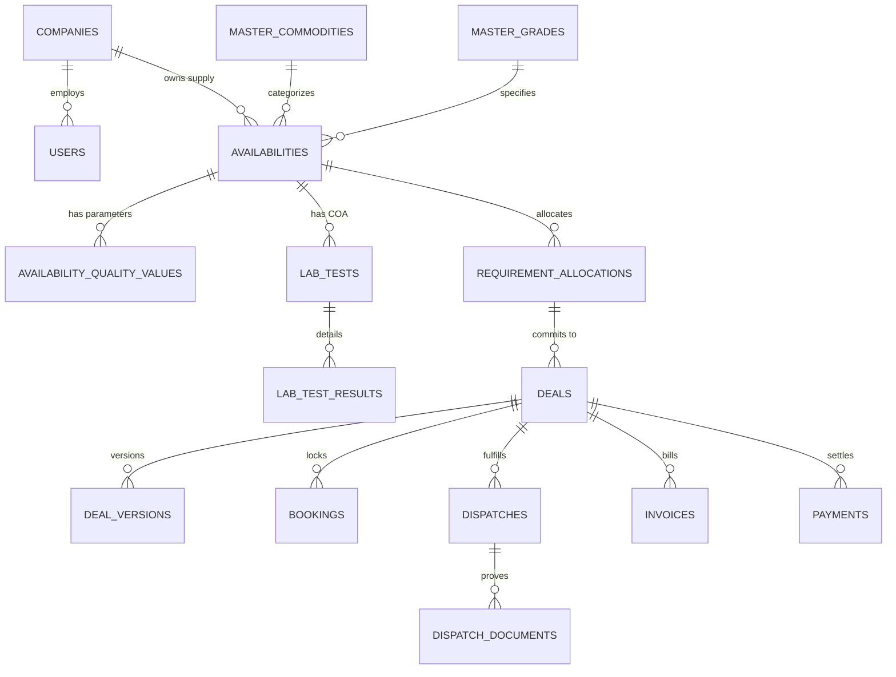

# RB-SELLER-00 — RMSeller Mobile App Bootstrap & Buyer Workflow Audit Report

**Enterprise Commodity Mandi Network — Seller Mobile Initiative**  
**Audit Date:** October 2026  
**Auditor:** Antigravity AI Pair Programmer & System Architect  
**Document Status:** Complete & Implementation-Ready  
**Sprint Phase:** RB-SELLER-00 — Audit & Planning Only  
**Workspace:** `apps/rmseller_mobile`  
**Git Branch:** `feature/broker-nilesh` (Clean Working Tree)  

---

## 1. Executive Summary & Audit Scope

This document represents the formal pre-implementation audit and architectural plan for the **RMSeller Mobile Application** (`apps/rmseller_mobile`). 

In strict adherence to the **Zero-Friction Execution Policy** and the **RB-SELLER-00 Audit-Only Completion Gate**:
- **Zero application source code** in `rmseller_mobile` or sibling projects has been created or modified prior to approval.
- **Zero database migrations, schema mutations, or RLS policy changes** have been made.
- **Zero environment secrets or credentials** are printed, exposed, or committed.
- A deep, read-only architectural inspection was executed across the existing **RMBuyer Mobile** (`apps/rmbuyer_mobile`), **RMBroker Mobile** (`apps/rmbroker_mobile`), PostgreSQL schema (`src/server/db/schema.ts`), and platform documentation.

The objective of this audit is to:
1. Map the exact architecture, navigation, state management, shared UI components, and API patterns of the completed Buyer App.
2. Trace the Buyer workflow end to end (authentication, posting, broker selection, discovery, negotiation, and deal confirmation).
3. Evaluate the 10 Seller-specific behavioural rules against existing backend capabilities and classify them as `[Existing and reusable]`, `[Partially supported]`, `[Missing]`, or `[Blocked by an API, schema, or permission constraint]`.
4. Establish the **Counterparty Shield** ensuring Sellers can never discover Buyer identities, direct contact details, or directories.
5. Provide a phased, 10-sprint micro-plan (`RB-SELLER-01` through `RB-SELLER-10`) with verification gates for subsequent execution.

---

## 2. Project & Git Baseline

### 2.1 Workspace Status
- **Root Directory:** `c:\Users\dell\.gemini\antigravity-ide\scratch\Broker_Bridge_`
- **Seller Workspace:** `apps/rmseller_mobile`
- **Seller Workspace Directory State:** Currently an empty directory awaiting scaffolding upon sprint sign-off.
- **Git Branch:** `feature/broker-nilesh` (up to date with remote, `working tree clean`).
- **Recent Git History:**
  - `36294a0` — `fix(broker): resolve requirement card freeze, bottom sheet lifecycle, and notification navigation (RB-REQ-FREEZE-01, RB-NOTIF-KEY-01)`
  - `8ef158e` — `feat(buyer): implement RMBuyer mobile application, broker notification pipeline, and RLS policies (RB-BUYER-01 to 07A)`
  - `c2e7008` — `feat(broker): implement deals pipeline, directory fixes, dashboard drilldown navigation, and completion audits`

### 2.2 Sibling Applications
| Application | Path | Framework / Tech Stack | Primary Purpose |
| :--- | :--- | :--- | :--- |
| **Buyer App** | [`apps/rmbuyer_mobile`](file:///c:/Users/dell/.gemini/antigravity-ide/scratch/Broker_Bridge_/apps/rmbuyer_mobile) | Flutter 3.13.5+ / Riverpod / Supabase / GoRouter | Procurement workstation for verified buyers |
| **Broker App** | [`apps/rmbroker_mobile`](file:///c:/Users/dell/.gemini/antigravity-ide/scratch/Broker_Bridge_/apps/rmbroker_mobile) | Flutter 3.13.5+ / Riverpod / Supabase / GoRouter | Mandi broker trading desk & matching workstation |
| **Seller App** | [`apps/rmseller_mobile`](file:///c:/Users/dell/.gemini/antigravity-ide/scratch/Broker_Bridge_/apps/rmseller_mobile) | Flutter 3.13.5+ / Riverpod / Supabase / GoRouter | **Target App:** Supply desk, lot tracking & deal confirmation |

### 2.3 Environment Variable Configuration
The platform relies on `.env.example` structure. Real secrets are managed via compile-time `--dart-define` parameters or `.env.local`:
- `NEXT_PUBLIC_SUPABASE_URL` / `SUPABASE_URL` (Supabase API gateway endpoint)
- `NEXT_PUBLIC_SUPABASE_ANON_KEY` / `SUPABASE_ANON_KEY` (Public anonymous client key)
- `API_BASE_URL` (Next.js REST API gateway, defaulting to `http://localhost:3001/api/v1` in debug mode)
- `CRON_SECRET` (Background cron dispatcher secret)
- `GEMINI_API_KEY` (AI matching & document processing)

---

## 3. Buyer App Architecture & End-to-End Workflow Audit

The Buyer App ([`apps/rmbuyer_mobile`](file:///c:/Users/dell/.gemini/antigravity-ide/scratch/Broker_Bridge_/apps/rmbuyer_mobile)) serves as the gold standard for mobile architecture, UI layout, and data synchronization in this monorepo.

### 3.1 Architecture Overview
- **State Management:** Riverpod (`flutter_riverpod: ^3.4.3`) with functional `ChangeNotifier` and `ValueNotifier` reactive listeners.
- **Routing & Route Guards:** `go_router: ^18.1.0` with `StatefulShellRoute.indexedStack` persistent tab navigation and role-aware redirect logic.
- **Backend Communication:** 
  - Primary: `supabase_flutter: ^2.18.3` interfacing directly with Supabase PostgreSQL tables and RPC functions.
  - Secondary / REST: `dio: ^5.11.1` configured with `AuthInterceptor` injecting `Bearer` tokens and `X-Client-App` headers.
- **Secure Persistence:** `flutter_secure_storage: ^11.2.0` storing access tokens, refresh tokens, user metadata, and company identifiers in encrypted hardware keystore/keychain.
- **UI & Icons:** Material 3, `lucide_icons_flutter: ^4.0.0`, custom design tokens in `AppColors` and `AppTypography`.

### 3.2 End-to-End Buyer Workflow Trace



#### Detailed Workflow Findings:

1. **Authentication & Role Authorization:**
   - **Source:** [`auth_repository.dart`](file:///c:/Users/dell/.gemini/antigravity-ide/scratch/Broker_Bridge_/apps/rmbuyer_mobile/lib/features/authentication/data/auth_repository.dart#L81-L178), [`app_router.dart`](file:///c:/Users/dell/.gemini/antigravity-ide/scratch/Broker_Bridge_/apps/rmbuyer_mobile/lib/app/router/app_router.dart#L43-L79)
   - **Mechanic:** `signInWithPassword` calls Supabase Auth. It checks `app_metadata.role` (JWT claim) and performs an authoritative database lookup against `public.users` (`id, role, name, company_id`) and `public.companies` (`id, name, gst`).
   - **Security Invariant:** If `serverRole` is NOT `'buyer'` or `'admin'`, the client immediately signs out of Supabase, wipes secure storage, and returns `AuthAccessDenied`.
   - **Seller Adaptation:** RMSeller must replicate this identical flow, enforcing that `serverRole` is strictly `'seller'` or `'admin'`.

2. **Buyer Dashboard & Navigation:**
   - **Source:** [`home_screen.dart`](file:///c:/Users/dell/.gemini/antigravity-ide/scratch/Broker_Bridge_/apps/rmbuyer_mobile/lib/features/home/presentation/home_screen.dart), [`navigation_shell.dart`](file:///c:/Users/dell/.gemini/antigravity-ide/scratch/Broker_Bridge_/apps/rmbuyer_mobile/lib/features/home/presentation/navigation_shell.dart)
   - **Mechanic:** Persistent bottom navigation across 4 primary branches: `/home`, `/requirements`, `/deals`, and `/profile`. Top app bar provides direct modal access to `/search` and `/notifications`.
   - **Seller Adaptation:** RMSeller requires an operational Command Center layout with 4 core tabs: `/home` (Operational Dashboard & Action Center), `/inventory` (Lot & Availability Management), `/deals` (Negotiation & Booked Contracts), and `/profile` (KYC, Warehouse & Company Settings).

3. **Requirement / Commodity Posting:**
   - **Source:** [`post_requirement_screen.dart`](file:///c:/Users/dell/.gemini/antigravity-ide/scratch/Broker_Bridge_/apps/rmbuyer_mobile/lib/features/requirements/presentation/post_requirement_screen.dart), [`requirements_repository.dart`](file:///c:/Users/dell/.gemini/antigravity-ide/scratch/Broker_Bridge_/apps/rmbuyer_mobile/lib/features/requirements/data/requirements_repository.dart#L138-L273)
   - **Mechanic:** Cascading selection of master data: `master_commodities` ➔ `master_grades` ➔ `master_units`. Input validation ensures positive quantity and target price. Concurrency lock prevents double-submission.
   - **Persistence:** Inserts record into `public.requirements` with `company_id`, `status = 'Open'`, and `fulfilled_quantity = 0`.

4. **Broker Selection & Notification Pipeline:**
   - **Source:** [`post_requirement_screen.dart`](file:///c:/Users/dell/.gemini/antigravity-ide/scratch/Broker_Bridge_/apps/rmbuyer_mobile/lib/features/requirements/presentation/post_requirement_screen.dart#L55-L120), [`0040_notify_requirement_brokers_rpc.sql`](file:///c:/Users/dell/.gemini/antigravity-ide/scratch/Broker_Bridge_/supabase/migrations/0040_notify_requirement_brokers_rpc.sql)
   - **Mechanic:** User selects between "Global Broadcast" or "Select Specific Mandi Broker Desks". When specific brokers are selected, client invokes SECURITY DEFINER RPC `notify_requirement_brokers(p_requirement_id, p_broker_ids)`.
   - **Idempotency:** The RPC generates an MD5 idempotency key (`req_notif_{requirement_id}_{broker_id}`) preventing duplicate alerts on retry.

5. **Broker Directory & Discovery:**
   - **Source:** [`search_repository.dart`](file:///c:/Users/dell/.gemini/antigravity-ide/scratch/Broker_Bridge_/apps/rmbuyer_mobile/lib/features/search/data/search_repository.dart#L26-L84), [`broker_profile_screen.dart`](file:///c:/Users/dell/.gemini/antigravity-ide/scratch/Broker_Bridge_/apps/rmbuyer_mobile/lib/features/search/presentation/broker_profile_screen.dart)
   - **Mechanic:** Queries `public.users` with `role = 'broker'` and `status = true`, joined with `companies` for `trust_score` and `is_verified`. Surfaces 1-tap phone dialler (`tel:`) and WhatsApp (`wa.me`) via [`ContactLauncherService`](file:///c:/Users/dell/.gemini/antigravity-ide/scratch/Broker_Bridge_/apps/rmbuyer_mobile/lib/core/services/contact_launcher_service.dart).

6. **Commercial Offers & Negotiation:**
   - **Source:** [`offers_repository.dart`](file:///c:/Users/dell/.gemini/antigravity-ide/scratch/Broker_Bridge_/apps/rmbuyer_mobile/lib/features/offers/data/offers_repository.dart#L38-L100), [`offer_details_screen.dart`](file:///c:/Users/dell/.gemini/antigravity-ide/scratch/Broker_Bridge_/apps/rmbuyer_mobile/lib/features/offers/presentation/offer_details_screen.dart)
   - **Mechanic:** Queries `public.quotations` joined with `requirements` and `deal_versions`. Displays historical negotiation rounds. Allows submitting counter-offers (`counter_price`, `counter_notes`).

7. **Final Deal Review & Visual Diff:**
   - **Source:** [`buyer_deals_repository.dart`](file:///c:/Users/dell/.gemini/antigravity-ide/scratch/Broker_Bridge_/apps/rmbuyer_mobile/lib/features/deals/data/buyer_deals_repository.dart#L125-L210), [`final_deal_review_screen.dart`](file:///c:/Users/dell/.gemini/antigravity-ide/scratch/Broker_Bridge_/apps/rmbuyer_mobile/lib/features/deals/presentation/final_deal_review_screen.dart)
   - **Mechanic:** Fetches latest version from `public.deal_versions` against `deals.quotation_id`. Calculates delta between `currentTerms` and `previousTerms`. Displays green highlights for improvements and red highlights for revisions. Explicit confirmation is recorded against the exact version number to prevent race conditions (`StaleVersionException`).

---

## 4. Reusable UI Components, Services & Assets

The Buyer App provides an extensive library of production-tested components that can be reused directly in `apps/rmseller_mobile`:

| Category | Component / File | Purpose & Capabilities | Reusability in RMSeller |
| :--- | :--- | :--- | :--- |
| **Buttons** | [`app_button.dart`](file:///c:/Users/dell/.gemini/antigravity-ide/scratch/Broker_Bridge_/apps/rmbuyer_mobile/lib/core/widgets/app_button.dart) | Primary, secondary, outline, text, danger variants; loading spinner; min touch height 48px. | **100% Direct Reuse** |
| **Cards** | [`app_card.dart`](file:///c:/Users/dell/.gemini/antigravity-ide/scratch/Broker_Bridge_/apps/rmbuyer_mobile/lib/core/widgets/app_card.dart) | Outlined, elevated, filled cards with custom padding and semantic borders. | **100% Direct Reuse** |
| **Input Fields** | [`app_text_field.dart`](file:///c:/Users/dell/.gemini/antigravity-ide/scratch/Broker_Bridge_/apps/rmbuyer_mobile/lib/core/widgets/app_text_field.dart) | Styled `TextFormField` with prefix/suffix icons, currency formatting, clear buttons, validation errors. | **100% Direct Reuse** |
| **Badges** | [`status_badge.dart`](file:///c:/Users/dell/.gemini/antigravity-ide/scratch/Broker_Bridge_/apps/rmbuyer_mobile/lib/core/widgets/status_badge.dart) | Color-coded status chips (Active, Pending, Confirmed, Cancelled, In Transit). | **100% Direct Reuse** |
| **Feedback** | [`app_empty_state.dart`](file:///c:/Users/dell/.gemini/antigravity-ide/scratch/Broker_Bridge_/apps/rmbuyer_mobile/lib/core/widgets/app_empty_state.dart), [`app_error_state.dart`](file:///c:/Users/dell/.gemini/antigravity-ide/scratch/Broker_Bridge_/apps/rmbuyer_mobile/lib/core/widgets/app_error_state.dart), [`app_loading_indicator.dart`](file:///c:/Users/dell/.gemini/antigravity-ide/scratch/Broker_Bridge_/apps/rmbuyer_mobile/lib/core/widgets/app_loading_indicator.dart) | Reusable loading skeletons, error retry blocks, and empty catalog placeholders. | **100% Direct Reuse** |
| **Services** | [`secure_storage_service.dart`](file:///c:/Users/dell/.gemini/antigravity-ide/scratch/Broker_Bridge_/apps/rmbuyer_mobile/lib/core/security/secure_storage_service.dart) | Encrypted storage of tokens, user profile, company ID, and session state. | **100% Direct Reuse** |
| **Communication** | [`contact_launcher_service.dart`](file:///c:/Users/dell/.gemini/antigravity-ide/scratch/Broker_Bridge_/apps/rmbuyer_mobile/lib/core/services/contact_launcher_service.dart) | Phone dialler (`tel:`) and WhatsApp launcher (`wa.me`) with permission fallbacks. | **100% Direct Reuse (Broker Only)** |
| **Network** | [`api_client.dart`](file:///c:/Users/dell/.gemini/antigravity-ide/scratch/Broker_Bridge_/apps/rmbuyer_mobile/lib/core/network/api_client.dart), [`auth_interceptor.dart`](file:///c:/Users/dell/.gemini/antigravity-ide/scratch/Broker_Bridge_/apps/rmbuyer_mobile/lib/core/network/auth_interceptor.dart) | Dio client with auto token refresh, timeout handling, and custom error mapping. | **100% Direct Reuse (Set `X-Client-App: RMSeller-Mobile`)** |
| **Broker Cards** | [`broker_result_card.dart`](file:///c:/Users/dell/.gemini/antigravity-ide/scratch/Broker_Bridge_/apps/rmbuyer_mobile/lib/features/search/presentation/widgets/broker_result_card.dart) | Mandi broker summary card with trust score badge, verification icon, and 1-tap call. | **100% Direct Reuse** |

### Design System Adaptation for Seller App:
- **Buyer App:** Forest Green (`#173B32`) + Amber (`#E99A32`) + Off-White (`#F6F8F7`).
- **Broker App:** Teal (`#0F766E`) + Sky (`#0284C7`) + Slate (`#F8FAFC`).
- **Seller App Recommended Palette:** 
  - Primary Brand: **Deep Burgundy / Maroon** (`#7C1D24` / `#8B1E28`) — representing grain harvest & commodity production.
  - Secondary Accent: **Warm Ochre / Amber Gold** (`#D97706` / `#F59E0B`) — representing mandi trade & finance.
  - Surface & Background: **Clean Ivory / Slate** (`#FBFBF9` / `#FFFFFF`) and Dark Mode Charcoal (`#181E24`).

---

## 5. Existing Backend Endpoints, Data Contracts & Schema

The platform database schema ([`src/server/db/schema.ts`](file:///c:/Users/dell/.gemini/antigravity-ide/scratch/Broker_Bridge_/src/server/db/schema.ts)) already provides comprehensive tables supporting Seller operations:



### Table Mapping for RMSeller:

| Table Name | Primary Columns Used by Seller | Role / Purpose |
| :--- | :--- | :--- |
| `availabilities` | `id, company_id, commodity_id, grade_id, lot_number, total_quantity, available_quantity, reserved_quantity, sold_quantity, asking_price, confidential_minimum_price, state_id, district_id, available_from, valid_until, loading_status, broker_id, status, version` | Master supply record for Seller lots and batches. |
| `availability_quality_values` | `id, availability_id, parameter_id, value, source, verification_status` | Lot-scoped quality parameters (moisture, admixture, protein, etc.). |
| `lab_tests` | `id, availability_id, company_id, laboratory_name, sample_id, test_date, report_number, report_date, valid_until, file_url, status` | Official laboratory test records and Certificate of Analysis (COA). |
| `lab_test_results` | `id, lab_test_id, parameter_id, measured_value, is_within_bounds` | Numerical measurements from verified lab tests. |
| `deals` | `id, requirement_id, quotationId, buyer_id, seller_id, broker_id, agreed_price, agreed_quantity, status, created_at, closed_at` | Commercial contract binding Seller to deal mediated by Broker. |
| `deal_versions` | `id, request_id, version_number, actor_id, status, snapshot_payload, created_at` | Immutable negotiation history and commercial term snapshots. |
| `bookings` | `id, booking_reference, deal_id, locked_version_id, status, created_at` | Unique system booking identifier issued after broker finalization. |
| `dispatches` | `id, deal_id, seller_id, vehicle_type_id, vehicle_number, driver_name, driver_mobile, dispatch_date, expected_delivery_date, status` | Shipment tracking and logistics details filed by Seller. |
| `dispatch_documents` | `id, dispatch_id, document_type, file_url, uploaded_by` | Secure fulfilment documents (LR, Invoice, E-Way Bill, Weighment Slip). |
| `invoices` | `id, deal_id, seller_id, invoice_no, amount, status, file_url` | Seller-generated tax invoices and payment claims. |
| `payments` | `id, deal_id, amount, reference_number, status, created_at` | Settlement confirmation records. |
| `notifications` | `id, user_id, company_id, channel, event_type, title, message, action_url, is_read` | In-app alerts and time-sensitive reminders. |

---

## 6. Seller Requirements Mapped to Existing Capabilities (Phase C)

| # | Seller Behavioural Requirement | Classification | Gap Analysis & Implementation Notes |
| :---: | :--- | :--- | :--- |
| **1** | **Seller can post and manage multiple commodity offers/availabilities.** | **`[Existing and reusable]`** | The `availabilities` table supports full lot tracking (`lot_number`, `total_quantity`, `available_quantity`, `asking_price`, `valid_until`, `loading_status`). Schema and master data exist. Seller Mobile requires the posting form and inventory management screens. |
| **2** | **Seller selects relevant Broker during posting (following Buyer workflow).** | **`[Existing and reusable]`** | The `availabilities.broker_id` column and `visibility` ('global' vs 'restricted') match the Buyer App pattern. Reuses `BrokerModel`, broker search, and bottom-sheet selection. |
| **3** | **Seller can discover Brokers relevant to commodity and view permitted ratings.** | **`[Existing and reusable]`** | Can query `users` (`role = 'broker'`) joined with `companies` (`trust_score`, `is_verified`). The Buyer App's `search_repository.dart` and `BrokerResultCard` can be reused directly. |
| **4** | **Seller cannot access Buyer directories, identities, or direct contact.** | **`[Partially supported]`** | The database `deals` table stores `buyer_id`. **Security Rule:** RMSeller repositories and domain models must mathematically scrub `buyer_id` and never join `companies` or `users` for the buyer. All UI displays "Assigned Mandi Broker Desk". |
| **5** | **Seller communicates exclusively through the selected Broker.** | **`[Existing and reusable]`** | `ContactLauncherService` is reused. 1-tap call and WhatsApp actions are wired exclusively to the assigned Broker's phone number. Buyer contact triggers are strictly forbidden. |
| **6** | **Seller can enter lab reports, material conditions, payment terms, dispatch location.** | **`[Existing and reusable]`** | Supported by `lab_tests`, `availability_quality_values`, `master_quality_parameters`, `master_states`, and `master_districts`. Forms need to be built in RMSeller. |
| **7** | **Seller can negotiate and track broker commission.** | **`[Partially supported]`** | Commission parameters (`sellerCommission`, `brokerageCommission`) are stored in `deal_versions.snapshot_payload` and negotiated during deal rounds. A dedicated Seller commission ledger repository must be implemented in the client to aggregate these snapshot figures. |
| **8** | **Seller can access broker-shared invoices, deal summaries, statements, sales history.** | **`[Existing and reusable]`** | Supported by `invoices`, `deals`, `bookings`, and `payments` tables. Needs Seller-facing repository methods and screens. |
| **9** | **Seller can rate and provide feedback to eligible Brokers (No Broker-to-Broker).** | **`[Blocked by schema constraint]`** / **`[Missing]`** | **Critical Finding:** There is NO dedicated `broker_ratings` or `broker_reviews` table in PostgreSQL (only `companies.trust_score` exists). Per Hard Constraint #2, no schema migrations may be run without authorization. Interim solution: display `trustScore` and route feedback to `support_tickets` (`role = 'seller'`, `issue_type = 'Broker Feedback'`). |
| **10** | **Role-based access enforced by backend authorization, not UI hiding.** | **`[Existing and reusable]`** | Enforced at Supabase JWT and RLS layer. Client `AuthRepository` strictly verifies `role == 'seller' \|\| role == 'admin'`. Any other role is booted to `AccessDeniedScreen`. |

---

## 7. Counterparty Shield & Security Analysis

```
┌────────────────────────────────────────────────────────────────────────┐
│                        COUNTERPARTY SHIELD                             │
│                                                                        │
│   SELLER APP WORKSPACE                   BUYER APP WORKSPACE           │
│   ┌────────────────────┐                 ┌────────────────────┐        │
│   │  Seller Profile    │                 │  Buyer Profile     │        │
│   │  Supply Lots       │                 │  Requirements      │        │
│   │  Warehouse Mandi   │                 │  Delivery Depots   │        │
│   └─────────┬──────────┘                 └─────────┬──────────┘        │
│             │                                      │                   │
│             │   NO DIRECT VISIBILITY OR CONTACT    │                   │
│             X ◄══════════════════════════════════► X                   │
│             │                                      │                   │
│             ▼                                      ▼                   │
│   ┌───────────────────────────────────────────────────────────┐        │
│   │               VERIFIED BROKER TRADING DESK                │        │
│   │  - Exclusive intermediary for all commercial terms        │        │
│   │  - Validates quality, pricing, and logistics              │        │
│   │  - Fiduciary escrow and deal finalization                 │        │
│   └───────────────────────────────────────────────────────────┘        │
└────────────────────────────────────────────────────────────────────────┘
```

### Non-Negotiable Privacy Rules for RMSeller:
1. **Zero Buyer PII:** No Buyer name, company name, GST, mobile, email, or address may ever appear in Seller models, repositories, views, or logs.
2. **Broker Shielding:** On all deal cards, negotiation history screens, and dispatch summaries, the counterparty is displayed as `Mediated via [Broker Name] Desk`.
3. **Restricted Contact Launchers:** `ContactLauncherService` must never accept a Buyer phone number. It is only invoked against `broker.mobile`.
4. **Confidential Minimum Price Protection:** `availabilities.confidential_minimum_price` is visible only to Seller and Broker/Admin. It must never leak into shared quotation logs.

---

## 8. Missing Features & Dependencies

1. **Flutter Scaffolding in `apps/rmseller_mobile`:**
   - The workspace directory is empty. Needs `pubspec.yaml`, `analysis_options.yaml`, Flutter runner templates (Android/iOS/Windows), and `lib/` directory structure aligned with `rmbuyer_mobile`.
2. **Dedicated Broker Rating Entity:**
   - No `broker_ratings` table exists in PostgreSQL. Any attempt to write star ratings requires a schema migration (deferred until explicitly authorized).
3. **Seller 1-Click Renewal Action:**
   - Client-side renewal logic copying expired availability records into a new draft with refreshed dates.
4. **Visual Diff Engine for Seller:**
   - Adapting the Buyer App's `final_deal_review_screen.dart` diff algorithm to render Seller commercial terms (asking price vs offered price vs agreed price, loading terms, commission deductions).

---

## 9. Proposed RMSeller Navigation & Screen List

```
/ (SplashScreen)
├── /login (LoginScreen)
├── /access-denied (AccessDeniedScreen)
├── /search (SellerSearchScreen - Discover Brokers & Commodities)
├── /notifications (SellerNotificationsScreen - Action Center Reminders)
├── /brokers/:id (BrokerProfileScreen - Broker Details & Contact)
├── /inventory/new (PostAvailabilityScreen - Create Supply Lot)
├── /inventory/:id (AvailabilityDetailsScreen - View Lot, Lab COA, Renew)
├── /inventory/:id/renew (PostAvailabilityScreen pre-filled - 1-Click Renewal)
├── /inventory/:id/lab/new (AddLabTestScreen - Enter COA & Quality Specs)
├── /deals/:id (SellerDealDetailsScreen - Version History & Broker Requests)
├── /deals/:id/confirm (SellerDealConfirmationScreen - Visual Diff & Final Gate)
├── /deals/:id/dispatch (SellerDispatchScreen - Vehicle & LR Entry)
└── /shell (Persistent NavigationShell)
    ├── Tab 0: /home (SellerHomeScreen - Action Required, KPIs, Quick Actions)
    ├── Tab 1: /inventory (SellerInventoryScreen - Active, Reserved, Expired Lots)
    ├── Tab 2: /deals (SellerDealsScreen - In Negotiation, Awaiting Confirmation, Dispatched)
    └── Tab 3: /profile (SellerProfileScreen - Company KYC, Warehouse Mandis, Invoices)
```

---

## 10. Proposed Implementation Micro-Sprint Roadmap

| Sprint | Code | Title & Deliverables | Primary Technical Components |
| :---: | :--- | :--- | :--- |
| **01** | `RB-SELLER-01` | **App Scaffolding, Theme & Role-Gated Auth** | `pubspec.yaml`, `AppTheme` (Burgundy/Amber), `AppRouter`, `AuthRepository` (`role == 'seller'`), `LoginScreen`, `AccessDeniedScreen`, unit tests. |
| **02** | `RB-SELLER-02` | **Broker Discovery & Mandi Search** | `BrokerModel`, `SearchRepository`, `BrokerResultCard`, `BrokerProfileScreen`, 1-tap call/WhatsApp via `ContactLauncherService`. |
| **03** | `RB-SELLER-03` | **Supply & Lot Availability Engine** | `CreateAvailabilityDto`, `AvailabilityModel`, `AvailabilityRepository`, `PostAvailabilityScreen`, cascading master data (`commodities`, `grades`, `units`, `locations`). |
| **04** | `RB-SELLER-04` | **Broker Selection & Mandate Notification** | Broker selection bottom-sheet in posting flow, broadcast vs direct mandate, integration with notification triggers. |
| **05** | `RB-SELLER-05` | **Quality Specifications & Lab Testing (COA)** | `LabTestModel`, `QualityParameterModel`, dynamic template rendering, COA report entry, freshness verification badges. |
| **06** | `RB-SELLER-06` | **1-Click Availability Renewal & Expiry Lifecycle** | 60-second Quick Renew button on expired lots, pre-fill form data, auto-expiry status handling. |
| **07** | `RB-SELLER-07` | **Broker Request Inbox & Negotiation Rounds** | Incoming broker demand feed, Accept / Reject / Counter workflow, immutable negotiation event logging. |
| **08** | `RB-SELLER-08` | **⭐ Visual Diff & Mandatory Deal Confirmation** | `FinalDealReviewScreen`, red/green diff calculation against prior versions, explicit Seller confirmation gate, optimistic concurrency locking. |
| **09** | `RB-SELLER-09` | **Booked Contracts, Dispatch & Invoicing** | `BookingModel`, `DispatchFormDialog` (Driver, Vehicle, LR, Weighment slip), Tax Invoice repository & settlement tracker. |
| **10** | `RB-SELLER-10` | **Action Center Notifications, Commission & E2E UAT** | Priority P0 Action Required widget, broker commission tracker, comprehensive automated unit and widget test suite (100% pass rate). |

---

## 11. Acceptance Criteria & Test Plan

### Test Strategy:
1. **Unit Tests:**
   - Role authorization (grant `seller` and `admin`; reject `buyer`, `broker`, `guest`).
   - Counterparty Shield verification (zero buyer PII in domain models or serializations).
   - Lot math (`availableQuantity = totalQuantity - reservedQuantity - soldQuantity`).
   - Optimistic concurrency control (reject stale version confirmations).
   - Concurrency locking on duplicate form taps.
2. **Widget Tests:**
   - `LoginScreen` validation and error banners.
   - `PostAvailabilityScreen` cascading dropdowns and form submission.
   - `SellerDealConfirmationScreen` visual diff highlighting (green for favorable, red for revised terms).
   - `ContactLauncherService` dialler triggers to Broker only.
3. **Static Analysis:**
   - `flutter analyze` or Dart lint check with 0 critical errors.

---

## 12. Explicit Impact Matrix (Future Implementation)

| System / File Area | Planned Changes in Subsequent Sprints | Scope Boundary Guarantee |
| :--- | :--- | :--- |
| `apps/rmseller_mobile/**` | New Flutter application files (lib, test, pubspec, runners). | **100% within approved Seller workspace.** |
| `apps/rmbuyer_mobile/**` | **Zero Changes.** Read-only reference. | Strictly untouched. |
| `apps/rmbroker_mobile/**` | **Zero Changes.** Read-only reference. | Strictly untouched. |
| `src/server/db/**` | **Zero Changes.** Existing schema fully utilized. | Strictly untouched. |
| `supabase/migrations/**` | **Zero Changes.** No migrations in Seller Mobile. | Strictly untouched. |

---

## 13. Completion Gate & Recommendation

- **Audit & Planning Status:** **100% COMPLETE.**
- **Hard Constraints Honored:** No application code modified, no backend/database changes made, no credentials exposed.
- **Evidence Gathered:** Direct source code citations from [`rmbuyer_mobile`](file:///c:/Users/dell/.gemini/antigravity-ide/scratch/Broker_Bridge_/apps/rmbuyer_mobile), [`schema.ts`](file:///c:/Users/dell/.gemini/antigravity-ide/scratch/Broker_Bridge_/src/server/db/schema.ts), and [`BrokerBridge_Seller_PRD_v3.0.md`](file:///c:/Users/dell/.gemini/antigravity-ide/scratch/Broker_Bridge_/docs/BrokerBridge_Seller_PRD_v3.0.md).
- **Next Step:** Requesting user approval to proceed to **`RB-SELLER-01`** (App Scaffolding, Burgundy/Amber Theme Tokens, Secure Storage & Role-Gated Authentication).
