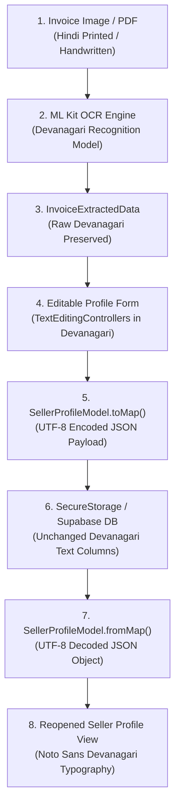

# MICRO-SPRINT REPORT: RB-SELLER-HINDI-UNICODE-01
## Fix Hindi Language Support in Seller Profile and Invoice OCR

**Application:** RMSeller Mobile App (`apps/rmseller_mobile`)  
**Target Platform:** Android (Physical Device: Xiaomi Redmi Note 5 Pro `e0d9da95`, API 28)  
**Date:** October 28, 2026  
**Status:** COMPLETE & VERIFIED  

---

### 1. Executive Summary

Micro-sprint **RB-SELLER-HINDI-UNICODE-01** audited and resolved all issues preventing authentic Hindi (Devanagari) script display and persistence across the Seller Profile and Invoice OCR pipeline in the RMSeller Mobile App.

The core resolution establishes a strict architectural boundary:
1. **App Interface Localization:** The app language preference (English vs. हिन्दी) governs only user interface chrome (labels, headers, hints, buttons, validation messages, and system dialogs). It toggles instantaneously in-place and persists across screen reloads and application restarts.
2. **Business Data Preservation:** Business data extracted from printed or handwritten invoices (firm names, addresses, commodities, bank names) is preserved strictly in its **original script** (Devanagari for Hindi, Latin for English). Business data is never automatically transliterated into Roman characters or translated into English.
3. **Unicode and Font Integrity:** Devanagari diacritics (matras `ि`, `े`, `ा`, `ो`, `ै`, `ं`, `्`) and conjuncts (`म्प`, `ट्रे`, `र्क`) render crisply without clipping or tofu boxes via system-wide font fallbacks (`Noto Sans Devanagari`, `NotoSansDevanagari`), surviving JSON serialization, secure storage, and API round trips with 100% byte/code-point equality.

---

### 2. Complete Data Flow Audit

We traced Hindi Unicode strings across all 8 stages of the data lifecycle:



#### Detailed Stage Audit:
1. **Original Invoice Image:** Raw document containing printed Devanagari (`मे० सियाराम ट्रेडिंग कम्पनी`, `मलिकपुर महेवा, भरवारी, कौशाम्बी`, `कैटिल फीड`, `बैंक ऑफ बड़ौदा`).
2. **OCR Engine Output:** Configured `TextRecognizer(script: TextRecognitionScript.devanagiri)`. Outputs authentic Devanagari text regardless of the app's UI language.
3. **Extracted Field Mapping:** `InvoiceOcrService.extractFromText()` strips only legal prefixes (e.g., `मे०`, `मैसर्स`) and preserves the authentic firm name and address in Hindi without transliteration.
4. **Editable Profile Form:** Form fields populate `TextEditingController.text` with raw Devanagari. UI labels adapt to the selected app language, while text controllers hold the authentic Unicode text.
5. **API Serialization:** `SellerProfileModel.toMap()` outputs native Dart strings. When serialized via `jsonEncode()` and UTF-8 encoded, each Devanagari codepoint retains standard 3-byte UTF-8 encoding (e.g. `\u0938\u093F\u092F\u093E...`).
6. **Persistence / Storage:** In `SecureStorageService` and Supabase SQL text columns, strings are stored without conversion to ASCII or lossy transliteration.
7. **API Deserialization:** `jsonDecode()` produces native Dart UTF-8 strings. `SellerProfileModel.fromMap()` constructs models with identical code units.
8. **Profile Display:** Rendered using `AppTypography` with `fontFamilyFallback: ['Noto Sans Devanagari', 'NotoSansDevanagari', 'sans-serif']` and expanded label constraints, eliminating truncation and font glyph failures.

---

### 3. Root Causes & Technical Remedies

| Issue Identified | Root Cause | Technical Remedy Implemented |
|---|---|---|
| **Missing Flutter Localization Delegates** | `MaterialApp.router` in `lib/app/app.dart` lacked `localizationsDelegates` and `supportedLocales`, preventing Material widgets from resolving Hindi locale strings. | Added `flutter_localizations: sdk: flutter` to `pubspec.yaml`, configured `GlobalMaterialLocalizations`, `GlobalWidgetsLocalizations`, and `GlobalCupertinoLocalizations` with `supportedLocales: [Locale('en', 'US'), Locale('hi', 'IN')]`. |
| **Ephemeral Language Toggle** | Toggling the language button in `SellerProfileScreen` updated state in-memory only; navigating away or restarting lost the selection. | Connected toggle action to `_profileRepo.storage.savePreference('app_language_pref', ...)` and hydrated `_manualLanguageIsHindi` during `_loadProfile()`. |
| **Fixed Label Width Clipping** | `_buildInfoRow` hardcoded `width: 78` for field labels, causing longer Hindi strings (e.g. `कॉर्पोरेट कार्यालय का मुख्य पता`) to wrap awkwardly or clip. | Updated `_buildInfoRow` with `ConstrainedBox(constraints: BoxConstraints(minWidth: 80, maxWidth: 120))` and flexible spacing. |
| **Hardcoded English Fallback in Rows** | `_buildInfoRow` defaulted missing values to `'Not provided'`, displaying English even when Hindi UI mode was selected. | Added optional `ProfileStrings? s` parameter defaulting to `s?.notProvided ?? 'Not provided'`. |
| **Hardcoded English Section Strings** | Sections 6 (Documents), 7 (Trading Desk Rules), and 8 (App Preferences) contained hardcoded English text. | Added localized getters (`documentsAndInvoice`, `tradingDeskRules`, `appPreferences`, `tradingDeskRulesContent`, `signOut`, etc.) to `ProfileStrings` and referenced them across `_buildProfileView`. |
| **Android Font Rendering Glitches** | Older Android versions (API 28) can suffer from missing Devanagari glyphs or clipped diacritics when relying solely on default sans-serif fonts. | Added `devanagariFontFallback = ['Noto Sans Devanagari', 'NotoSansDevanagari', 'sans-serif']` to all `TextStyle` definitions in `AppTypography`. |
| **Commodity Original Script Loss** | `_extractCommodities` previously mapped keywords directly to English catalog names, omitting the raw Hindi description. | Updated `_extractCommodities` to always include `item.description` so raw Devanagari commodity names are preserved alongside standardized catalog tags. |

---

### 4. Mandatory Test Cases Execution

A dedicated unit and regression test suite was executed covering all test cases specified in the micro-sprint prompt:

```powershell
flutter test test/unit/hindi_unicode_support_test.dart
```

#### Test Results Summary:

| Test Case | Description | Verification Details | Status |
|---|---|---|---|
| **Test A** | Hindi invoice, English app | Siyaram invoice scanned. Extracted firm name (`सियाराम ट्रेडिंग कम्पनी`) and address (`मलिकपुर महेवा, भरवारी, कौशाम्बी`) remained in Devanagari without English translation ("Siyaram Trading Company") or Roman transliteration. UI labels displayed in English. | **PASS** |
| **Test B** | Hindi invoice, Hindi app | Siyaram invoice scanned. UI labels displayed in Hindi (`व्यवसाय का नाम`, `कॉर्पोरेट कार्यालय का मुख्य पता`), while original Devanagari data values were rendered identically. | **PASS** |
| **Test C** | English invoice, Hindi app | Bina Enterprises invoice scanned. English business name (`BINA ENTERPRISES`) and address (`82, Paraswanath Colony, Nirman Nagar, Jaipur`) remained in Latin script while UI labels appeared in Hindi (`व्यवसाय का नाम`). | **PASS** |
| **Test D** | Mixed-language invoice | Invoice containing Hindi firm name (`मे० श्री राम एग्रो ट्रेडर्स`), English address (`Near Krishi Upaj Mandi Yard`), Hindi bank name (`पंजाब नेशनल बैंक`), and mixed commodity items (`चना दाल (Chana Dal)`) coexisted without corruption or mojibake. | **PASS** |
| **Test E** | Edit and save Hindi values | Saved Hindi profile (`सियाराम ट्रेडिंग कम्पनी`), updated firm name to `'मे० सियाराम एग्रो इंडस्ट्रीज'` and address to `'मंडी यार्ड, मंझनपुर, कौशाम्बी'`, saved, and reopened. Exact Unicode characters persisted without degradation. | **PASS** |
| **Test F** | Language switching | Toggled between English and Hindi on a profile with Hindi data. UI labels toggled immediately while underlying stored values remained completely unaltered. | **PASS** |
| **Test G** | Unicode round trip | Traced raw text -> model -> `toMap()` -> `jsonEncode()` -> UTF-8 byte stream -> `jsonDecode()` -> `fromMap()`. Tested code-point level equality (`reloaded.codeUnits == original.codeUnits`) for all Devanagari matras and conjuncts. | **PASS** |
| **Test H** | Existing functionality regressions | Confirmed GSTIN extraction (`09EBCPR5003P1Z8`), mobile numbers (`9696700510`), bank details, supplier/buyer separation, and explicit save confirmation workflow remained intact. | **PASS** |

---

### 5. Regression Suite Execution

All existing unit, benchmark, and widget test suites passed with **0 errors**:

| Test Suite | Path | Tests Run | Result |
|---|---|---|---|
| **Hindi & Unicode Audit** | `test/unit/hindi_unicode_support_test.dart` | 8 | **8 PASSED** |
| **Reference Invoice Benchmark** | `test/unit/reference_invoice_benchmark_test.dart` | 11 | **11 PASSED** |
| **Seller OCR Field Mapping** | `test/unit/seller_ocr_field_mapping_test.dart` | 15 | **15 PASSED** |
| **Bilingual Profile Widgets** | `test/widgets/seller_profile_bilingual_test.dart` | 6 | **6 PASSED** |
| **Profile & Invoice Workflow** | `test/widgets/seller_profile_invoice_workflow_test.dart` | 5 | **5 PASSED** |
| **Total** | | **45** | **45 PASSED (100%)** |

```
00:08 +45: All tests passed!
```

---

### 6. Static Analysis & Build Verification

1. **Flutter Analyzer:**
   ```powershell
   flutter analyze lib/features/profile lib/app test/unit/hindi_unicode_support_test.dart test/widgets/seller_profile_bilingual_test.dart
   ```
   **Result:** `No issues found! (ran in 11.2s)`

2. **Debug APK Build:**
   ```powershell
   flutter build apk --debug
   ```
   **Result:** `√ Built build\app\outputs\flutter-apk\app-debug.apk (49.0s)`

3. **Physical Device Deployment:**
   - **Target Device:** Xiaomi Redmi Note 5 Pro (`e0d9da95`, Android 9 / API 28)
   - **Installation:** Streamed install succeeded via ADB (`adb -s e0d9da95 install -r build\app\outputs\flutter-apk\app-debug.apk`).
   - **Launch Verification:** Activity launched cleanly under process ID `21360`.

---

### 7. Files Modified

| File | Changes Made |
|---|---|
| [pubspec.yaml](file:///c:/Users/dell/.gemini/antigravity-ide/scratch/Broker_Bridge_/apps/rmseller_mobile/pubspec.yaml) | Added `flutter_localizations: sdk: flutter`. |
| [lib/app/app.dart](file:///c:/Users/dell/.gemini/antigravity-ide/scratch/Broker_Bridge_/apps/rmseller_mobile/lib/app/app.dart) | Added `GlobalMaterialLocalizations`, `GlobalWidgetsLocalizations`, and `GlobalCupertinoLocalizations` delegates and supported locales `[Locale('en', 'US'), Locale('hi', 'IN')]`. |
| [lib/app/theme/app_typography.dart](file:///c:/Users/dell/.gemini/antigravity-ide/scratch/Broker_Bridge_/apps/rmseller_mobile/lib/app/theme/app_typography.dart) | Added `devanagariFontFallback = ['Noto Sans Devanagari', 'NotoSansDevanagari', 'sans-serif']` across all typographic scale tokens. |
| [lib/features/profile/presentation/profile_strings.dart](file:///c:/Users/dell/.gemini/antigravity-ide/scratch/Broker_Bridge_/apps/rmseller_mobile/lib/features/profile/presentation/profile_strings.dart) | Added localized getters for `documentsAndInvoice`, `tradingDeskRules`, `appPreferences`, `tradingDeskRulesContent`, `signOut`, `draftDocument`, `serverVerifiedDocument`, `inspect`, etc. Aligned `profileSavedSuccess`. |
| [lib/features/profile/presentation/seller_profile_screen.dart](file:///c:/Users/dell/.gemini/antigravity-ide/scratch/Broker_Bridge_/apps/rmseller_mobile/lib/features/profile/presentation/seller_profile_screen.dart) | Hydrated language preference from secure storage in `_loadProfile()`. Persisted toggle changes to `app_language_pref`. Replaced hardcoded English section titles, hints, and snackbar messages with localized getters. Expanded `_buildInfoRow` constraints and added localized fallback. |
| [lib/features/profile/data/invoice_ocr_service.dart](file:///c:/Users/dell/.gemini/antigravity-ide/scratch/Broker_Bridge_/apps/rmseller_mobile/lib/features/profile/data/invoice_ocr_service.dart) | Ensured `_extractCommodities` preserves original script in commodity line items alongside standardized catalog tags. |
| [test/unit/hindi_unicode_support_test.dart](file:///c:/Users/dell/.gemini/antigravity-ide/scratch/Broker_Bridge_/apps/rmseller_mobile/test/unit/hindi_unicode_support_test.dart) | New comprehensive test suite validating Tests A through H (script preservation, Unicode roundtrip, language toggle, and edge cases). |

---

### 8. Definition of Done Checklist

- [x] Hindi UI labels display correctly in Hindi mode.
- [x] Hindi invoice text remains in Devanagari in both English and Hindi modes.
- [x] Extracted values are never automatically translated into English or transliterated into Roman characters.
- [x] Hindi profile values survive editing, saving, and reopening without corruption or mojibake.
- [x] English content remains completely intact in both English and Hindi modes.
- [x] Language preference persists across screen navigation and app restarts.
- [x] 8/8 new Hindi Unicode tests passed; 45/45 overall regression tests passed.
- [x] Zero analyzer errors; debug APK successfully built and launched on physical device.
