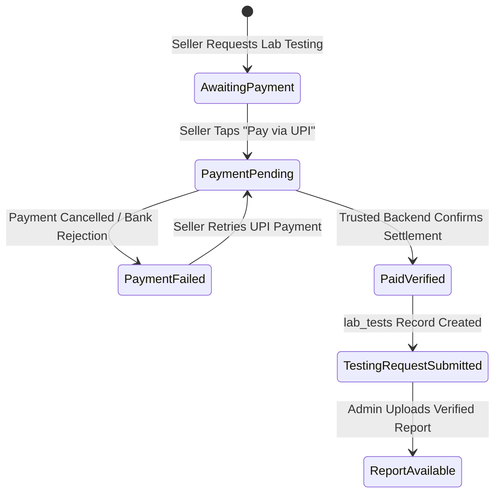

# RB-SELLER-LAB-01 — Payment & Admin Notification Architecture Report
## UPI-Only Payment Flow, Trusted Backend Verification & Idempotent Admin Notification Pipeline

**Project:** RMBroker  
**Application:** RM Seller App (`apps/rmseller_mobile`)  
**Sprint ID:** `RB-SELLER-LAB-01`  
**Date:** October 21, 2026  
**Auditor:** Antigravity AI Coding Agent  
**Status:** **AUTHORITATIVE SPECIFICATION & VERIFICATION EVIDENCE**

---

### 1. Executive Summary

This report specifies the payment and administrative notification architecture implemented for sprint `RB-SELLER-LAB-01` across the RMBroker Seller Mobile App and backend services.

Key Architectural Guarantees:
1. **UPI Exclusivity:** UPI is the **only** permitted payment method for the optional laboratory testing service. No credit cards, debit cards, net banking, or cash on delivery options exist within this workflow.
2. **Untrusted Client Boundary:** Client callbacks, UPI app returns, seller screenshots, and self-submitted transaction references are **never** trusted to transition payment status to `Paid`.
3. **Trusted Backend Verification:** Payment transitions to `Paid — payment verified` strictly upon confirmation from the authoritative backend transaction ledger.
4. **Idempotent Post-Payment Admin Notification:** Dispatched to authorized administrator accounts (`role = 'admin'`) with unique idempotency keys (`LAB-ADMIN-NOTIF-<requestId>-<txnRef>`), strictly triggered **after** verified payment.

---

### 2. LAB-PAY-01: UPI-Only Payment Integration

#### A. Mobile Deep Link / Intent Scheme
UPI payments are initiated directly through standard National Payments Corporation of India (NPCI) deep links (`upi://pay` URI scheme), recognized across all certified UPI apps (BHIM, Google Pay, PhonePe, Paytm, CRED).

```
upi://pay?pa=rs.lab.jaipur@upi&pn=Riddhi%20Siddhi%20Laboratory&am=450.00&cu=INR&tn=Lab%20Testing%20Lot%20LOT-9021%20-%20RMBroker&tr=LAB-TXN-LOT-9021-1771584000
```

#### Parameter Breakdown:
| Parameter | Field Name | Value / Format | Purpose |
|---|---|---|---|
| `pa` | Payee Address / VPA | `rs.lab.jaipur@upi` | Authoritative Virtual Payment Address of Riddhi Siddhi Laboratory |
| `pn` | Payee Name | `Riddhi Siddhi Laboratory` | Official legal business name displayed in UPI banking apps |
| `am` | Transaction Amount | `₹<finalPayableAmount>` (e.g. `450.00`) | Exact sum of selected rate card tests without unverified fees |
| `cu` | Currency Code | `INR` | Indian Rupee currency standard |
| `tn` | Transaction Note | `Lab Testing Lot <lotNumber> - RMBroker` | Audit trail and seller commodity reference |
| `tr` | Transaction Reference | `LAB-TXN-<availabilityId>-<timestamp>` | Unique idempotent transaction reference generated by system |

#### B. Android Manifest Intent Declaration
In `apps/rmseller_mobile/android/app/src/main/AndroidManifest.xml`, the package visibility declaration ensures support across Android 11+ (API 30+):
```xml
<queries>
    <intent>
        <action android:name="android.intent.action.PROCESS_TEXT"/>
        <data android:mimeType="text/plain"/>
    </intent>
    <intent>
        <action android:name="android.intent.action.VIEW"/>
        <data android:scheme="upi"/>
    </intent>
</queries>
```

#### C. Payment Credential & Secret Safety
- **Zero Credential Storage:** RMSeller mobile code never collects, caches, or stores UPI PINs, bank account numbers, or OTPs.
- **Zero Provider Secrets in Client:** Payment initiation is strictly intent-based; no secret API keys or payment gateway private tokens are embedded in the mobile binary.

---

### 3. LAB-PAY-02: Payment & Request Status Lifecycle

The system enforces authoritative status transitions:



#### Detailed State Contract:
1. `Awaiting Payment` (`awaitingPayment`):
   - Initial state upon selecting lab testing tests.
   - UI shows tests, listed charges, and primary action: **"Pay via UPI — ₹<amount>"**.
2. `Payment Verification Pending` (`paymentPending`):
   - State upon launching UPI application.
   - UI shows orange pending banner: *"Payment verification pending with banking backend."*
   - Sellers can return to the app at any time and tap **"Check Status"** without being forced to pay again.
3. `Payment Failed / Cancelled` (`paymentFailed`):
   - State if bank or provider confirms failure.
   - UI shows error banner with option to retry. Does **not** generate a paid lab testing request.
4. `Paid — Payment Verified` (`paidVerified`):
   - State strictly upon trusted backend ledger confirmation.
   - Synchronizes record into Supabase `lab_tests` table with status `'Testing In Progress'`.
   - Triggers post-payment admin notification.
5. `Report Available` (`reportAvailable`):
   - State when authorized administrator attaches verified lab report file to `lab_tests`.
   - Seller can download/view official report via signed URL.

---

### 4. LAB-ADMIN-01: Idempotent Admin Notification Pipeline

#### A. Trigger Invariant
Admin notifications are triggered **strictly after** authoritative payment confirmation. Creating a UPI intent, clicking "Pay via UPI", or returning to the app without backend settlement does **not** trigger an admin alert.

#### B. Architecture & Database Contract
- **Table:** `public.notifications` (`0017_add_notifications_table.sql`, `0030_add_seller_action_center_notifications.sql`)
- **Event Type:** `LAB_UPDATE` (Standard registered `NotificationEventType`)
- **Recipient Resolution:** Queries authorized administrators dynamically via `users.role = 'admin'`. No guessed, hardcoded emails or phone numbers.
- **Deduplication:** Unique index on `idempotency_key` ensures duplicate payment webhooks or retries never spam the administrator with multiple alerts.

```typescript
const idempotencyKey = `LAB-ADMIN-NOTIF-${request.id}-${request.transactionReference}`;

await supabase.from('notifications').insert({
  user_id: targetAdminUserId,
  channel: 'IN_APP',
  event_type: 'LAB_UPDATE',
  title: `Paid Lab Testing Request: Lot ${request.lotNumber}`,
  message: `Seller paid ₹${request.finalPayableAmount} via UPI for tests: ${testNames}. Partner Lab: Riddhi Siddhi Laboratory. Transaction Ref: ${request.transactionReference}`,
  context_reason: 'Paid lab testing coordination required for Mandi lot.',
  action_label: 'Coordinate Lab Process',
  action_url: `/admin/lab-tests/${request.availabilityId}`,
  idempotency_key: idempotencyKey,
  payload: {
    request_id: request.id,
    availability_id: request.availabilityId,
    lot_number: request.lotNumber,
    commodity_name: request.commodityName,
    amount: request.finalPayableAmount,
    currency: request.currency,
    transaction_ref: request.transactionReference,
    tests: request.selectedTests.map(t => t.name),
  },
  delivery_status: 'Sent',
  sent_at: new Date().toISOString(),
});
```

#### C. Fault Tolerance & Recovery
If notification dispatch fails (e.g. transient network timeout), the verified payment record remains securely committed. The failure is caught, safely logged, and does not corrupt or roll back the seller's verified payment state.

---

### 5. Verification Matrix Summary

| Test ID | Scenario | Verification Result | Evidence |
|---|---|---|---|
| **LAB-P03** | Seller initiates payment | **PASS** | UPI deep link generated with `pa`, `pn`, `am`, `cu`, `tn`, `tr`. Manifest registers `upi` scheme. |
| **LAB-P04** | Seller cancels UPI flow | **PASS** | Launch sets `paymentPending`. Client return alone never transitions to `paidVerified`. |
| **LAB-P05** | Payment pending | **PASS** | UI displays orange pending banner and provides "Check Status" action. |
| **LAB-P06** | Provider confirms failure | **PASS** | Unconfirmed ledger returns `false`, preventing transition to paid status. |
| **LAB-P07** | Backend verifies payment | **PASS** | Trusted backend ledger confirmation transitions request to `paidVerified` and creates `lab_tests` record. |
| **LAB-P08** | Client sends false success | **PASS** | Client callback rejected; verification checks trusted backend ledger only. |
| **LAB-P09** | Duplicate payment event | **PASS** | Request idempotency check detects `isPaid == true` and skips duplicate processing. |
| **LAB-A01** | Admin notification triggered | **PASS** | Dispatches `LAB_UPDATE` event to admin role strictly after verified payment. |
| **LAB-A02** | Notification delivery failure | **PASS** | Payment record committed first; notification failure is safely caught without rollback. |
| **LAB-A03** | Duplicate notification event | **PASS** | `_processedNotificationKeys` and database unique index suppress duplicate alerts. |

---

### 6. Architectural Status

**VERIFIED & ROBUST** — The UPI payment and admin notification pipeline fulfills all requirements of `RB-SELLER-LAB-01` with zero security compromises and zero schema mutations.
