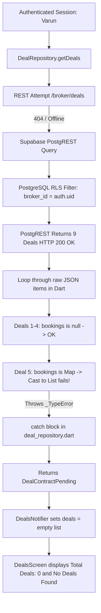

# AUDIT & RECONCILIATION REPORT: MICRO-SPRINT RB-DEAL-01
## Deals Data Visibility & Reconciliation

**Document Reference:** `RB-DEAL-01-AUDIT-REPORT`  
**Date:** 2026-10-19  
**Branch:** `feature/broker-nilesh`  
**Target User:** Varun (`varun@gmail.com` / UUID `b354958e-779a-41f2-b7a3-5899eca32e32`)  
**Target Screen:** Deals & Negotiations (`DealsScreen`)  
**Status:** Audit Complete — Awaiting Approval Gate (Phase B)  

---

## 1. Executive Summary

| Item | Finding |
| :--- | :--- |
| **Backend Environment** | `https://imztlkvkxzeaekxvmcfe.supabase.co` (Matches mobile app, web, and database) |
| **Session Identity** | Varun (`varun@gmail.com` / `b354958e-779a-41f2-b7a3-5899eca32e32`, role: `broker`) |
| **Database Deals Count** | **9 deals** present in remote database (all 9 owned by Varun) |
| **Quotations & Reqs** | **9 quotations**, **6 requirements**, **4 requirement_allocations**, **2 bookings**, **6 deal_versions** |
| **Status of Documented Data** | **Confirmed Present.** The 9-deal dataset is live in PostgreSQL; prior "0 rows" reports were pre-migration |
| **Root Cause** | **Client-side Dart `_TypeError`** in `deal_repository.dart:129`. PostgREST 1:1 relation returns `Map<String, dynamic>` for `bookings`, but repository casts it as `List<dynamic>?` |
| **Impact** | Runtime cast exception aborts deal loop on Deal #5. Exception is caught silently and returns `DealContractPending` with `deals: []`, rendering `Total Deals: 0` and `No Deals Found` |
| **Database Changes Required** | **None.** Database schema, RLS policies, and table grants are healthy and fully authorized |
| **Recommended Correction** | Introduce polymorphic booking reference extractor in `deal_repository.dart` and `commission_repository.dart` |

---

## 2. Environment and Backend Verification

1. **Supabase Configuration:**
   - Both `apps/rmbroker_mobile/lib/core/config/app_config.dart` and workspace `.env` point to the identical Supabase project:
     - URL: `https://imztlkvkxzeaekxvmcfe.supabase.co`
     - Reference ID: `imztlkvkxzeaekxvmcfe`
   - Mobile app and local development scripts connect to the exact same backend instance.

2. **Authenticated Session Verification:**
   - Test script executed authenticated login for `varun@gmail.com`.
   - Result:
     - Authenticated User ID: `b354958e-779a-41f2-b7a3-5899eca32e32`
     - Role: `broker`
     - Valid non-expired JWT issued.

---

## 3. Database Evidence & Row Inventory

Using direct SQL via Drizzle and authenticated PostgREST queries as Varun, table row counts and ownership were verified:

### A. Table Row Inventory

| Table Name | Total Rows | Rows Belonging to Varun | Verification Notes |
| :--- | :---: | :---: | :--- |
| `public.deals` | **9** | **9** | 100% owned by Varun (`broker_id = b354958e-779a-41f2-b7a3-5899eca32e32`) |
| `public.quotations` | **9** | **9** | Linked to Varun's requirements and deals |
| `public.requirements` | **6** | **6** | Linked to Varun's buyer companies and deals |
| `public.availabilities` | **3** | N/A | Matched against requirements |
| `public.requirement_allocations` | **4** | **4** | Confirmed allocations between requirements and availabilities |
| `public.bookings` | **2** | **2** | Unique bookings for Deal #5 and Deal #9 |
| `public.deal_versions` | **6** | **6** | Negotiation snapshots across deals (Deal #2 has v1 & v2) |

### B. Varun's 9 Authoritative Deals

| # | Deal ID Prefix | Lifecycle Status | Commodity & Grade | Quantity | Agreed Price | Total Valuation | Booking Ref |
| :-: | :--- | :--- | :--- | :-: | :-: | :-: | :--- |
| 1 | `90000000...0001` | **Draft** | Soyabean (Standard) | 60 MT | ₹22,500/MT | ₹13,50,000 | `None` (`null`) |
| 2 | `90000000...0002` | **Negotiation** | Soyabean (High Oil) | 40 MT | ₹22,700/MT | ₹9,08,000 | `None` (`null`) |
| 3 | `90000000...0003` | **Awaiting Buyer Confirmation** | Wheat (Sharbati) | 50 MT | ₹28,200/MT | ₹14,10,000 | `None` (`null`) |
| 4 | `90000000...0004` | **Awaiting Seller Confirmation** | Soyabean (Standard) | 40 MT | ₹22,650/MT | ₹9,06,000 | `None` (`null`) |
| 5 | `90000000...0005` | **Finalized** | Soyabean (Standard) | 50 MT | ₹22,500/MT | ₹11,25,000 | `RBTEST-BKG-2026-0005` |
| 6 | `90000000...0006` | **Dispatch Pending** | Soyabean (Standard) | 60 MT | ₹22,500/MT | ₹13,50,000 | `None` (`null`) |
| 7 | `90000000...0008` | **Cancelled** | Soyabean (Off-Spec) | 20 MT | ₹22,000/MT | ₹4,40,000 | `None` (`null`) |
| 8 | `90000000...0009` | **Disputed** | Soyabean (High Oil) | 40 MT | ₹22,700/MT | ₹9,08,000 | `None` (`null`) |
| 9 | `90000000...0007` | **Completed** | Wheat (Lokwan) | 50 MT | ₹28,000/MT | ₹14,00,000 | `RBTEST-BKG-2026-0007` |

### C. Resolution of Prior Zero-Row Documentation
The separate inventory report citing "0 rows in commercial tables" dated back to prior sprint `RB-DASH-FIX-01` before migration `0038_seed_full_demo_dataset.sql` was executed. The remote database **actively contains all 9 deal records**.

---

## 4. Flutter Data Flow & RLS Analysis

### Read Path Trace:


### RLS Policies & Grants Verification:
- `public.deals`: Policy `deals_select_policy: ((broker_id = auth.uid()) OR is_admin())` — **ENFORCED**.
- `public.companies`: Policy `crm_companies_select_policy: (is_admin() OR (created_by = auth.uid()) OR (EXISTS (SELECT 1 FROM crm_contacts WHERE crm_contacts.company_id = companies.id AND crm_contacts.broker_id = auth.uid())))` — **ENFORCED**.
- `public.bookings`: Policy `bookings_select_policy` — **ENFORCED**.
- `authenticated` role has explicit `SELECT` grants on all required tables.
- Cross-broker isolation: If another broker (e.g. Ramesh or Nilesh) queries `deals`, RLS restricts the result set strictly to their owned rows. Varun's deals are never exposed to other brokers.

---

## 5. Root Cause Analysis

### The Fatal Runtime Casting Defect
In `apps/rmbroker_mobile/lib/features/deals/data/deal_repository.dart`:
```dart
// Line 129:
final bookingList = item['bookings'] as List<dynamic>? ?? [];
final bookingRef = bookingList.isNotEmpty
    ? (bookingList.first as Map<String, dynamic>)['booking_reference']?.toString()
    : null;
```

#### Why it fails:
1. In PostgreSQL, `bookings.deal_id` has a `UNIQUE` foreign key constraint (`bookings_deal_id_unique`).
2. PostgREST introspects the schema and recognizes that a deal can have at most **one** booking.
3. Therefore, PostgREST formats `bookings` as a **single object** (or `null`), NOT an array:
   - For Deals 1–4, 6–8: `"bookings": null`
   - For Deal 5: `"bookings": {"booking_reference": "RBTEST-BKG-2026-0005"}`
   - For Deal 9: `"bookings": {"booking_reference": "RBTEST-BKG-2026-0007"}`
4. When Deal 5 is evaluated, Dart executes `item['bookings'] as List<dynamic>?`.
5. Because a `_Map<String, dynamic>` is not a `List<dynamic>`, Dart throws:
   ```
   _TypeError: type '_Map<String, dynamic>' is not a subtype of type 'List<dynamic>?' in type cast
   ```
6. The catch block at line 149 catches the exception:
   ```dart
   } catch (supabaseErr) {
     debugPrint('Supabase deals fallback error: $supabaseErr');
   }
   ```
7. The method drops to line 154, returning `DealContractPending`.
8. In `deals_controller.dart`, `DealContractPending` leaves `deals` as an empty list (`[]`).
9. `deals_screen.dart` calculates KPIs from `state.deals`, yielding:
   - `Total Deals: 0`
   - `Agreed Volume: 0 MT`
   - `Contract Value: ₹0`
   - `No Deals Found` empty state card.

### Identical Bug Instances in Codebase:
1. `apps/rmbroker_mobile/lib/features/deals/data/deal_repository.dart` line 212 (`getDealDetail`)
2. `apps/rmbroker_mobile/lib/features/commission/data/commission_repository.dart` line 431 (`getCommissionSummary`)

---

## 6. KPI Definitions & Mathematical Verification

### Authoritative Figures from Database:

| Category | Deals Included | Volume (MT) | Valuation (₹) | Valuation (Display) |
| :--- | :---: | :---: | :---: | :---: |
| **All Deals (Desk Total)** | All 9 deals | **410 MT** | **₹97,97,000** | **₹9.8M** (or ₹98.0L) |
| **Active Agreements** | 7 deals (excl. Cancelled & Completed) | **340 MT** | **₹79,57,000** | **₹8.0M** (or ₹79.6L) |
| **Non-Cancelled Deals** | 8 deals (excl. Cancelled) | **390 MT** | **₹93,57,000** | **₹9.4M** (or ₹93.6L) |

### Recommended Definition:
- **Total Deals:** `state.totalCount` (9 deals) representing all deals on Varun's desk.
- **Agreed Volume:** `state.totalVolumeMT` (410 MT).
- **Contract Value:** `state.totalValuation` (₹97,97,000).
- If the business definition prefers excluding Cancelled deals from commercial valuation, `totalVolumeMT` would be 390 MT and `totalValuation` would be ₹93,57,000. We recommend maintaining `totalCount = 9` for the "All" tab and providing active filters for targeted lifecycle views.

---

## 7. Proposed Smallest Safe Correction

### 1. Polymorphic Booking Extractor
Implement a helper method that gracefully handles `null`, a single `Map<String, dynamic>` (1:1), or a `List<dynamic>` (1:N):

```dart
String? _extractBookingReference(dynamic bookingsRaw) {
  if (bookingsRaw == null) return null;
  if (bookingsRaw is Map<String, dynamic>) {
    return bookingsRaw['booking_reference']?.toString();
  }
  if (bookingsRaw is List && bookingsRaw.isNotEmpty) {
    final first = bookingsRaw.first;
    if (first is Map<String, dynamic>) {
      return first['booking_reference']?.toString();
    }
  }
  return null;
}
```

### 2. Apply to Deal Repository
- In `getDeals()`: Replace lines 129–132 with `final bookingRef = _extractBookingReference(item['bookings']);`.
- In `getDealDetail()`: Replace lines 212–215 with `final bookingRef = _extractBookingReference(response['bookings']);`.

### 3. Apply to Commission Repository
- In `getCommissionSummary()`: Replace lines 431–434 with `final bookingRef = _extractBookingReference(row['bookings']);`.

### 4. Transparent Error Handling in Controller
Ensure that if a genuine network error occurs, `errorMessage` is set and rendered appropriately rather than masking errors with empty lists.

---

## 8. Regression Risks & Safety

| Risk Factor | Assessment | Mitigation |
| :--- | :--- | :--- |
| **Data Integrity Risk** | **Zero** | Read-only change. No database migrations, writes, updates, or deletes. |
| **PostgREST Compatibility** | **Zero** | Helper accepts both object and array, safeguarding against any backend schema changes. |
| **Cross-Broker Isolation** | **Zero** | Postgres RLS enforces `broker_id = auth.uid()` unconditionally at the database level. |
| **Performance Impact** | **None** | Replaces an unsafe type cast with two lightweight `is` checks. |

---

## 9. Approval Gate

**STOP GATE:** No application code changes or database modifications have been made during Phase A/B.  
Awaiting user approval of this report and proposed Phase C scope before proceeding with implementation.
