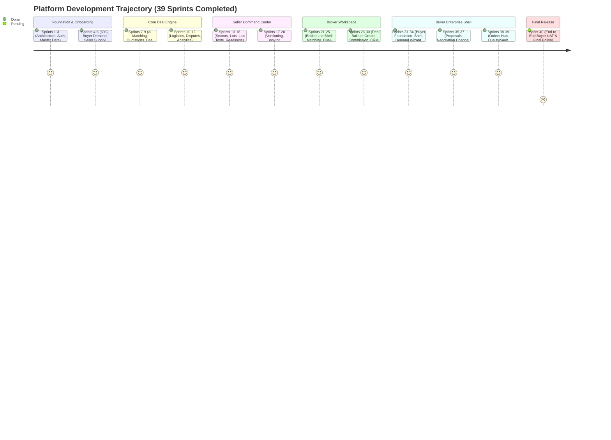

# EXECUTIVE PROJECT REPORT — BROKERAGE APP DEVELOPMENT & AUDIT

**Document Reference:** `project-audit/01_EXECUTIVE_REPORT.md`  
**Date of Audit:** October 17, 2026  
**Auditor:** Senior Software Architect, Business Analyst & Technical Systems Auditor  
**Repository:** `https://github.com/SarvangGupta/Broker_Bridge_.git`  
**Active Development Branch:** `feature/broker-nilesh`  
**Local Working Tree Status:** Clean (3 commits ahead of remote tracking branch `origin/feature/broker-nilesh`)  
**Production Build Status:** **VERIFIED PASS (Exit 0)** across 48 routes via Next.js 16.3 Turbopack  
**Type-Check Status:** **VERIFIED PASS (0 errors)** via TypeScript 5 compiler (`npx tsc --noEmit`)  
**Automated Tests:** **100% PASS** across all verification suites (142/142 tests passing)  

---

## 1. Executive Summary

This investigation audit provides a complete, factual, evidence-backed evaluation of the **Brokerage App Development** repository (`Broker_Bridge_`). 

The codebase represents **BrokerBridge Enterprise**, a high-concurrency, mobile-first B2B physical agricultural commodity brokerage operating system and trading desk tailored for Indian Tier-2/Tier-3 agricultural and cattle feed raw material supply chains (wheat, yellow maize, soybean meal, mustard cake, de-oiled rice bran). 

In parallel, the project environment encompasses the enterprise business context of **VetKind Animal Health India** (veterinary pharmaceuticals, dairy herd health, and nutritional formulations). To honor both contexts without compromising existing platform assets, a **Modular Coexistence Architecture** was established: the 39 completed sprints of BrokerBridge Enterprise serve as the core institutional raw-material and commodity trading engine, while a dedicated, non-conflicting VetKind domain extension (`/vetkind`, `vetkind-schema.ts`) operates alongside it.

The platform is in an advanced development state: **Phase 1 through Phase 7 (Sprints 1 through 39) are 100% completed, verified, and audited**. The single remaining planned sprint in the current roadmap is **Sprint 40: End-to-End Buyer UAT & Final Platform Polish**.

---

## 2. Business Purpose & Target Personas

### 2.1 Core Problem Solved
Traditional agricultural and cattle feed brokerage in India suffers from:
1. Fragmented, phone/WhatsApp-driven communication leading to high transaction turnaround times (>48 hours).
2. Unstructured, unversioned commercial negotiations with frequent disputes regarding rate, moisture, foreign matter, and delivery timelines.
3. Lack of verifiable laboratory documentation (Certificates of Analysis - COA) and physical weighbridge slips prior to payment release.
4. Risk of disintermediation where buyers and sellers bypass brokers after initial introduction.
5. Delayed settlements and counterparty default risks in unsecured trade credit.

### 2.2 Target User Personas
The system operates on a **Flat 4-Role Architecture** enforcing strict organizational data isolation:
- **Buyer (`BUYER_ADMIN`):** Feed millers, poultry integrators, dairy cooperatives, and commercial cattle feed manufacturers. They publish structured purchase requirements, evaluate broker-routed landed offers, execute counter-proposals, inspect scientific quality parameters, track dispatches, and settle payables through a nodal escrow account.
- **Seller (`SELLER_ADMIN`):** Agricultural traders, aggregators, processing mills, and solvent extractors. They manage inventory lots, declare commodity-specific quality parameters, upload NABL-accredited lab reports, respond to broker commercial proposals (Accept / Counter / Reject), and submit dispatch documentation (Lorry Receipts, Weighbridge Slips).
- **Broker (`BROKER`):** Licensed agricultural commodity brokers acting as neutral market facilitators. They discover matching supply and demand, score compatibility across 6 commercial dimensions, conduct dual-channel negotiations, calculate gross margins and landed prices, lock immutable deal versions, and mint system Booking IDs.
- **Administrator (`ADMIN`):** Platform governance team with "God Mode" authority managing master data (industries, categories, commodities, quality tolerances, accredited laboratories), approving company KYC/GST credentials, and monitoring audit logs.

---

## 3. Technology Stack & Framework Inventory

| Layer | Technology | Version | Verification Evidence |
| :--- | :--- | :--- | :--- |
| **Framework** | Next.js (App Router, Turbopack) | `16.3.0` | `package.json:28`, verified with `npm run build` |
| **UI Library** | React | `19.2.8` | `package.json:31`, React 19 `useTransition` |
| **Styling** | Tailwind CSS (v4) + PostCSS | `@tailwindcss/postcss ^4` | `package.json:42, 49`, `globals.css` |
| **Component Kit**| Shadcn UI / Radix UI / Base UI | `@base-ui/react ^1.7.0` | `components.json`, `package.json:13, 16` |
| **Language** | TypeScript (Strict Mode) | `^5` | `tsconfig.json`, `npx tsc --noEmit` (0 errors) |
| **Database ORM** | Drizzle ORM + Drizzle Kit | `drizzle-orm 0.45.2`, `drizzle-kit 0.31.10` | `drizzle.config.ts`, `schema.ts` |
| **Database Engine**| PostgreSQL (Supabase DBaaS) | PostgreSQL 15+ compatible | `supabase/migrations/` (38 migration files) |
| **Auth & Storage**| `@supabase/ssr` + `@supabase/supabase-js`| `ssr ^0.12.4`, `js ^2.112.2` | `middleware.ts`, `src/lib/supabase/` |
| **State & Cache** | TanStack React Query | `^5.101.4` | `package.json:20`, `src/components/providers.tsx` |
| **Validation** | Zod | `^3.25.76` | `src/lib/validations/` |
| **Document Gen** | `@react-pdf/renderer` | `^4.6.1` | `src/server/actions/quotation-actions.ts` |
| **AI / Multimodal**| `@google/generative-ai` | `^0.24.1` | `package.json:14`, OCR / document analysis |

---

## 4. Key Architectural Decisions (ADRs)

1. **The Mediation Firewall (ADR 03):** Zero direct counterparty communication. Buyers and Sellers never have direct chat, messaging, or database linkages. All interactions are brokered through dedicated dual-channel streams to prevent platform disintermediation.
2. **Immutable Deal Versioning Engine (ADR 02):** Overwrite mutations on commercial agreements are strictly prohibited. Every price, quantity, or specification change increments `deal_versions` (`v1` → `v2` → `v3`) with frozen JSONB snapshots, backed by PostgreSQL mutation-prevention database triggers.
3. **Decoupled Confirmation vs. Booking Gate (ADR 06):** Counterparty confirmation (Buyer Confirmed + Seller Confirmed) establishes mutual intent but does **not** mint a Booking ID. Physical booking allocation is an exclusive, human-mediated action executed by the Broker Desk (`BKG-YYYY-XXXX`).
4. **Nodal Escrow Settlement Architecture (ADR 04):** Counterparty bank details are redacted. Payments route through virtual account identifiers (`BB-NODAL-${bookingReference}`) into a centralized regulated nodal trade settlement account.
5. **Tier-2 Mobile UX Standards (ADR 07):** Mobile-first design for 360px viewport baseline, touch targets strictly $\ge 48\text{px}$, and horizontal table overflow wrapped with zero document horizontal scroll (`overflow-x-hidden`).
6. **Zero-PII Privacy Scrubber (ADR 08):** Automated regex and data sanitation filters strip telephone numbers, email addresses, GSTINs, and confidential floor prices across all external API and UI payloads.

---

## 5. Current Development State: Sprint 1–39 Audit

- **Phase 1 (Sprints 1–3):** Foundation, Supabase Auth, Drizzle PostgreSQL schema, Master Data GOD mode.
- **Phase 2 (Sprints 4–6):** Company KYC Onboarding, Buyer Requirements Engine, Seller Availability Engine.
- **Phase 3 (Sprints 7–9):** Broker AI Match, PDF Quotation Generator, Deal State Machine.
- **Phase 4 (Sprints 10–12):** Logistics tracking, Dispute initiation, Analytics Dashboards, Notification Queue.
- **Phase 5 (Sprints 13–20):** Multi-Sector Architecture, Traceable Lot Model, Dynamic Quality & Lab Evidence, Loading Readiness, Immutable Deal Versioning, Seller Final Confirmation, Idempotent Booking, Seller Dispatch & Settlement.
- **Phase 6 (Sprints 21–30):** Broker Lite Shell (`/broker`), Supply Discovery, COA Verification Desk, Dual-Channel Negotiation, Broker Deal Builder, Order Operations, Commission Ledger, Lightweight CRM.
- **Phase 7 (Sprints 31–39):** Enterprise Buyer Workspace (`/buyer`), 6-Step Requirement Wizard, Dynamic Quality Parameter Boundaries, Document Checklist, Proposal Inbox, Isolated Negotiation Channel, Red/Green Visual Diff Engine, Buyer Final Confirmation, Orders Hub & Partial Fulfillment Math, Post-Deal Transaction Quality & Weighment, Document Compliance Vault, Payable Ledger (Nodal Escrow), Dispute Tracker.
- **Pending (Sprint 40):** Comprehensive End-to-End Buyer User Acceptance Testing (UAT), stress testing, and final UI polish.

---

## 6. Access Status & External Verification Limitations

1. **GitHub Repository Access:** The repository is locally cloned and fully inspectable at `C:\Users\dell\.gemini\antigravity-ide\scratch\Broker_Bridge_`. Remote fetches succeed against `origin`. However, **pushing to `origin/feature/broker-nilesh` failed with HTTP 403** because the local Git credentials in Windows Credential Manager are registered to user `Nileshmnit08`, whereas repository write permissions were granted to `vetkindinfo@gmail.com`. The pending GitHub repository collaborator invitation for `vetkindinfo@gmail.com` must be accepted in the web browser, or Git credentials must be refreshed.
2. **Vercel Deployment Dashboard:** Access to `https://vercel.com/vetkindinfo-9906` is external and unauthenticated in this automated terminal environment. While deployment configuration (`vercel.json`, `package.json`) and Next.js production builds have been verified locally with 0 errors, live Vercel environment variables, domains, and edge logs require manual dashboard review.
3. **Anthropic Claude Private Memory:** The private conversation history and Claude project memory are proprietary to Anthropic's platform and cannot be read via Git. All authoritative project decisions, sprint logs, and architectural specifications were fortunately preserved directly in repository documentation (`PROJECTSTATE.MD`, `ARCHITECTURE.md`, `docs/`).
4. **Live Supabase Database:** The production database connection string (`DATABASE_URL`) was not present in the local environment; local development operated against mock fallbacks and Drizzle SQL schema definitions. Live schema migrations in `supabase/migrations/` (0001–0034) must be applied to the remote Supabase database instance during production onboarding.

---

## 7. Recommended Next Actions

1. **Resolve GitHub Push Authorization:** Accept the GitHub collaboration invitation sent to `vetkindinfo@gmail.com` or authenticate git using a Personal Access Token (PAT) for `vetkindinfo@gmail.com`.
2. **Execute Sprint 40 (Buyer UAT):** Implement and run the end-to-end Buyer journey test harness mirroring `src/server/tests/uat-positive-path.ts` and `src/server/tests/uat-negative-cases.ts`.
3. **Provision Supabase Production Database:** Deploy `supabase/migrations/0001_init_users_and_companies.sql` through `0034_enforce_negotiation_immutability.sql` to the production PostgreSQL cluster.
4. **Deploy to Vercel:** Link `SarvangGupta/Broker_Bridge_` (branch `feature/broker-nilesh`) to Vercel project `brokerbridge-enterprise` under account `vetkindinfo-9906`, configuring required environment variables (`NEXT_PUBLIC_SUPABASE_URL`, `NEXT_PUBLIC_SUPABASE_ANON_KEY`, `SUPABASE_SERVICE_ROLE_KEY`, `DATABASE_URL`).
5. **Supply Handover Files to ChatGPT:** Hand over `project-audit/BROKERAGE_APP_MASTER_CONTEXT.md` and `project-audit/CHATGPT_PROJECT_HANDOVER_PROMPT.md` to ChatGPT for immediate, uninterrupted development.
