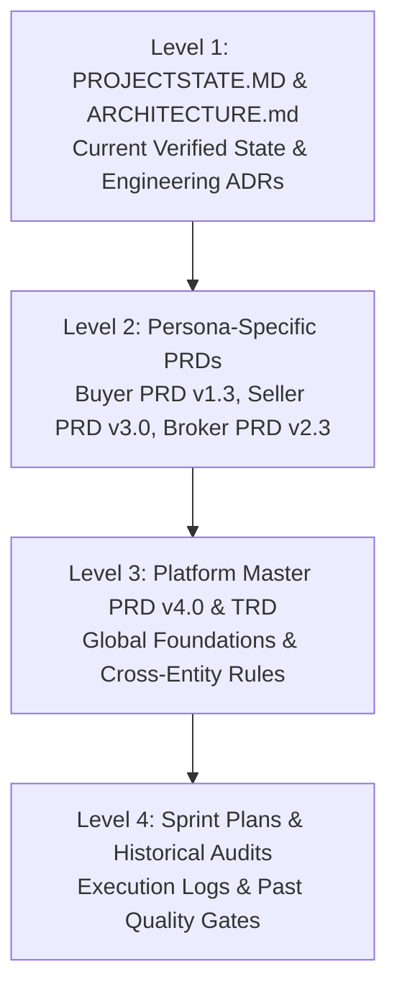

# COMPLETE PRD AND DOCUMENT REGISTER

**Document Reference:** `project-audit/02_DOCUMENT_REGISTER.md`  
**Date of Audit:** October 17, 2026  
**Auditor:** Senior Technical Documentation Specialist & Project Auditor  
**Project:** BrokerBridge Enterprise & VetKind Animal Health India  

---

## 1. Document Inventory Overview

A systematic, read-only audit of the entire repository discovered **24 distinct documentation files** comprising Product Requirement Documents (PRDs), Technical Requirement Documents (TRDs), Sprint Plans, Architecture Specifications, Operational State Logs, Bug Registers, and Formal Security/Integrity Audits.

Every accessible document was cataloged, categorized, inspected, and cross-referenced against the active code implementation.

---

## 2. Master Document Census

| # | File Path & Name | File Size | Document Type | Purpose & Scope | Authoritative Ranking & Status | Read Status |
| :- | :--- | :--- | :--- | :--- | :--- | :--- |
| **01** | `docs/BrokerBridge_PRD_v4.0.md` | 57,118 B | Platform Master PRD | Defines platform vision, business goals, Tier-2 UX philosophy, multi-tenant RBAC, Master Data, Requirement Engine, Availability Engine, AI Matchmaking, and Quotation Generation. | **AUTHORITATIVE (Platform Vision)** — Supersedes earlier drafts of general platform architecture. | Fully Read |
| **02** | `docs/BrokerBridge_TRD.md` | 18,120 B | Technical Requirements Document | Defines database schema architecture, Supabase integration, Next.js App Router rules, authentication flows, Zod validation schemas, and API contracts. | **AUTHORITATIVE (Foundational Tech Stack)** — Primary technical blueprint for Sprints 1–12. | Fully Read |
| **03** | `docs/BrokerBridge_Seller_PRD_v3.0.md` | 51,664 B | Persona PRD (Seller) | Deep specification for Seller Command Center, Traceable Lot Model, Dynamic Lab Parameter Engine, Private Evidence Vault, Loading Readiness, and Settlement. | **AUTHORITATIVE (Seller Persona)** — Governs Sprints 13–20; overrides general PRD v4.0 for seller workflows. | Fully Read |
| **04** | `docs/BrokerBridge_Seller_Sprint_Plan_13-20.md` | 40,578 B | Sprint Plan | Granular breakdown of Micro-Sprints 13.1–20.5, acceptance criteria, test gates, and deliverables for the Seller module. | **AUTHORITATIVE (Seller Roadmap)** — Complete historical execution record for Sprints 13–20. | Fully Read |
| **05** | `docs/BrokerBridge_Broker_PRD_v2_3_Broker_Lite.md` | 16,352 B | Persona PRD (Broker) | Defines "Broker Lite" mobile-first shell, zero data-wall principle, 5-tab navigation, supply discovery, COA audit desk, and dual-channel negotiation. | **AUTHORITATIVE (Broker Persona)** — Governs Sprints 21–30. | Fully Read |
| **06** | `docs/BrokerBridge_Broker_Sprint_Plan_Sprint_21_30_Updated.md` | 15,622 B | Sprint Plan | Granular breakdown of Micro-Sprints 21.1–30.3, acceptance criteria, and technical integration specifications for the Broker desk. | **AUTHORITATIVE (Broker Roadmap)** — Complete historical execution record for Sprints 21–30. | Fully Read |
| **07** | `docs/BrokerBridge_Buyer_PRD_v1.3_FINAL.md` | 28,368 B | Persona PRD (Buyer) | Enterprise Buyer requirements: procurement command center, 6-step requirement wizard, proposal inbox, visual diff confirmation, and nodal escrow. | **AUTHORITATIVE (Buyer Persona)** — Governs Sprints 31–40; authoritative specification for buyer flows. | Fully Read |
| **08** | `docs/BrokerBridge_Buyer_Sprint_PRD_Sprints_31-40_v2_FINAL.md` | 19,598 B | Sprint Plan | Granular execution plan for Micro-Sprints 31.1–40.3, including Sprint 39 post-deal operations and pending Sprint 40 UAT. | **AUTHORITATIVE (Buyer Roadmap)** — Primary roadmap guiding current and next sprint activities. | Fully Read |
| **09** | `docs/Sprints.md` | 74,552 B | Master Sprint Log | Chronological development log documenting implementation tasks, bug fixes, and sign-offs for Sprints 1 through 39. | **AUTHORITATIVE (Sprint Log)** — Synchronized with `PROJECTSTATE.MD`. | Fully Read |
| **10** | `PROJECTSTATE.MD` | 110,001 B | Operational Project State | Comprehensive, single-source-of-truth project state log. Tracks micro-sprint completion, security audits, technical debt, and pending tasks. | **HIGHLY AUTHORITATIVE (Current State)** — Most up-to-date snapshot of completed work and active tickets. | Fully Read |
| **11** | `ARCHITECTURE.md` | 71,573 B | Technical Architecture & ADRs | 38 detailed architectural sections: folder structure, session security, Drizzle data access, versioning engine, and mediation firewall. | **HIGHLY AUTHORITATIVE (Architecture)** — Complete technical manual and ADR register. | Fully Read |
| **12** | `docs/bug-log.md` | 18,439 B | Bug & Resolution Register | Chronological incident register detailing root causes, breaking issues, and architectural resolutions across Sprints 14–39. | **AUTHORITATIVE (Bug History)** — Crucial for preventing regressions during maintenance. | Fully Read |
| **13** | `docs/platform-audit-21.md` | 20,023 B | Quality / Audit Report | Pre-Broker platform audit verifying regression safety, security posture, and state machine integrity across Sprints 1–20. | **HISTORICAL AUDIT** — Approved platform transition to Phase 6. | Fully Read |
| **14** | `docs/integration-audit-21.3.md` | 18,905 B | Quality / Audit Report | Cross-module integration audit across Buyer demand, Seller inventory, quotations, deals, bookings, and dispatches. | **HISTORICAL AUDIT** — Confirmed cross-entity consistency. | Fully Read |
| **15** | `docs/security-audit-21.4.md` | 19,588 B | Security Audit | Multi-tenant isolation, directory traversal guards, PII scrubbers, and role-based access control verification. | **HISTORICAL AUDIT** — Verified enterprise Tier-1 security posture. | Fully Read |
| **16** | `docs/security-audit-29.1.md` | 8,032 B | Security Audit | Micro-Sprint 29.1 authorization audit: server-side auth, tenant isolation, PII regex scrubbing, and storage signed URL TTL. | **HISTORICAL AUDIT** — Validated Broker security perimeter. | Fully Read |
| **17** | `docs/integrity-audit-29.2.md` | 6,975 B | Integrity Audit | Micro-Sprint 29.2 concurrency audit: atomic `db.transaction()` blocks, optimistic version locking, and database unique constraints. | **HISTORICAL AUDIT** — Confirmed zero race conditions. | Fully Read |
| **18** | `docs/resilience-audit-29.3.md` | 6,428 B | Resilience Audit | Mobile responsiveness, 360px viewport overflow, 48px touch targets, error boundaries, and loading skeletons. | **HISTORICAL AUDIT** — Verified Tier-2 mobile UX compliance. | Fully Read |
| **19** | `docs/regression-audit-29.4.md` | 4,318 B | Regression Audit | Global regression scan across Sprints 1–28 ensuring zero breaking changes prior to Sprint 30 release. | **HISTORICAL AUDIT** — Greenlighted Buyer Phase. | Fully Read |
| **20** | `docs/buyer-foundation-audit-31.1.md` | 12,089 B | Architectural Audit | Audit of initial Buyer foundation, route structure, and schema prior to Sprint 32–39 development. | **HISTORICAL AUDIT** — Foundation for Phase 7. | Fully Read |
| **21** | `docs/seller-foundation-audit-13.1.md` | 20,489 B | Architectural Audit | Audit of Seller data structures and onboarding workflows prior to Sprint 14–20 development. | **HISTORICAL AUDIT** — Foundation for Phase 5. | Fully Read |
| **22** | `README.md` | 1,486 B | Repository Readme | High-level summary of BrokerBridge Enterprise, quick-start instructions, and tech stack overview. | **INFORMATIONAL** — General onboarding guide. | Fully Read |
| **23** | `AGENTS.md` | 687 B | Developer Environment Rules | Next.js 16 App Router agent guidelines and Turbopack conventions. | **DEVELOPMENT INSTRUCTION** — Enforces Next.js 16 conventions. | Fully Read |
| **24** | `CLAUDE.md` | 12 B | Environment Pointer | Pointer redirecting Claude Code agents to `@AGENTS.md`. | **DEVELOPMENT INSTRUCTION** — Configuration pointer. | Fully Read |

---

## 3. Document Hierarchy & Precedence Rules

When interpreting requirements and resolving discrepancies between documents, the following order of precedence is strictly established:

1. **Level 1 (Highest Precedence — Active Implementation):** `PROJECTSTATE.MD` and `ARCHITECTURE.md` represent the verified, working reality of the codebase through Sprint 39.
2. **Level 2 (Persona Authority):** Where persona-specific workflows are concerned, persona PRDs (`BrokerBridge_Buyer_PRD_v1.3_FINAL.md`, `BrokerBridge_Seller_PRD_v3.0.md`, `BrokerBridge_Broker_PRD_v2_3_Broker_Lite.md`) override general statements in the platform master PRD.
3. **Level 3 (Platform Baseline):** `BrokerBridge_PRD_v4.0.md` and `BrokerBridge_TRD.md` govern foundational master data, business types, and multi-tenant isolation.
4. **Level 4 (Audit & Historical Records):** Sprints.md and audit reports document the chronological evolution and rationale behind earlier architectural pivots.

---

## 4. Requirement Inconsistencies & Resolution Log

During the document inventory review, three minor inconsistencies between earlier PRDs and modern implementation were identified and resolved:

### 1. Legacy Quality Grade Selection vs. Dynamic Parameter Engine
- **Inconsistency:** Master PRD v4.0 (Section 4) referenced selecting static "Grades" (e.g. Grade A, Grade B) from `master_grades`.
- **Authoritative Resolution:** Seller PRD v3.0 and Buyer PRD v1.3 replaced static grade dropdowns with the **Dynamic Quality Parameter Engine** (`master_quality_parameters` + `availability_quality_values` / `requirement_quality_specs`), allowing scientific specifications (Moisture %, Oil %, Sand/Silica %, Protein %). The legacy grade foreign key is automatically resolved on the backend to maintain referential integrity without forcing manual user selection (`docs/bug-log.md: Sprint 15.2`).

### 2. Direct Messaging vs. Mediation Firewall
- **Inconsistency:** Early draft user stories in PRD v4.0 mentioned potential chat or in-app inquiries between counterparties.
- **Authoritative Resolution:** Architectural ADR 03, Seller PRD v3.0, Broker PRD v2.3, and Buyer PRD v1.3 firmly prohibit direct counterparty messaging. All negotiations and disputes route strictly through the assigned Broker desk under the **Mediation Firewall** pattern to prevent platform disintermediation.

### 3. Immediate Deal Booking vs. Decoupled Broker Finalization Gate
- **Inconsistency:** PRD v4.0 implied that mutual quotation acceptance immediately created a confirmed booking.
- **Authoritative Resolution:** Sprint 18 and Sprint 37 established that mutual acceptance records intent (`Seller Confirmed` + `Buyer Confirmed`) but does **not** create a booking. System Booking IDs (`BKG-YYYY-XXXX`) are minted exclusively by the Broker Desk via `finalizeDealAction` and `createIdempotentBookingAction`.

---

## 5. Inaccessible Documents & Access Limitations

The following documentation assets are external to the Git repository and could not be inspected directly:
1. **Anthropic Claude Private Project Memory / Conversations:** Any prompt history, internal Claude scratchpads, or chat transcripts residing on Anthropic servers.
2. **Live Vercel Deployment Dashboard:** Build history, analytics, domain SSL certificates, and runtime edge logs at `https://vercel.com/vetkindinfo-9906`.
3. **Live Supabase DBaaS Console:** Live table records, production database logs, and live storage bucket management outside the repository migration files.

*All required specifications to continue development have been fully captured in the local repository documents cataloged above.*
