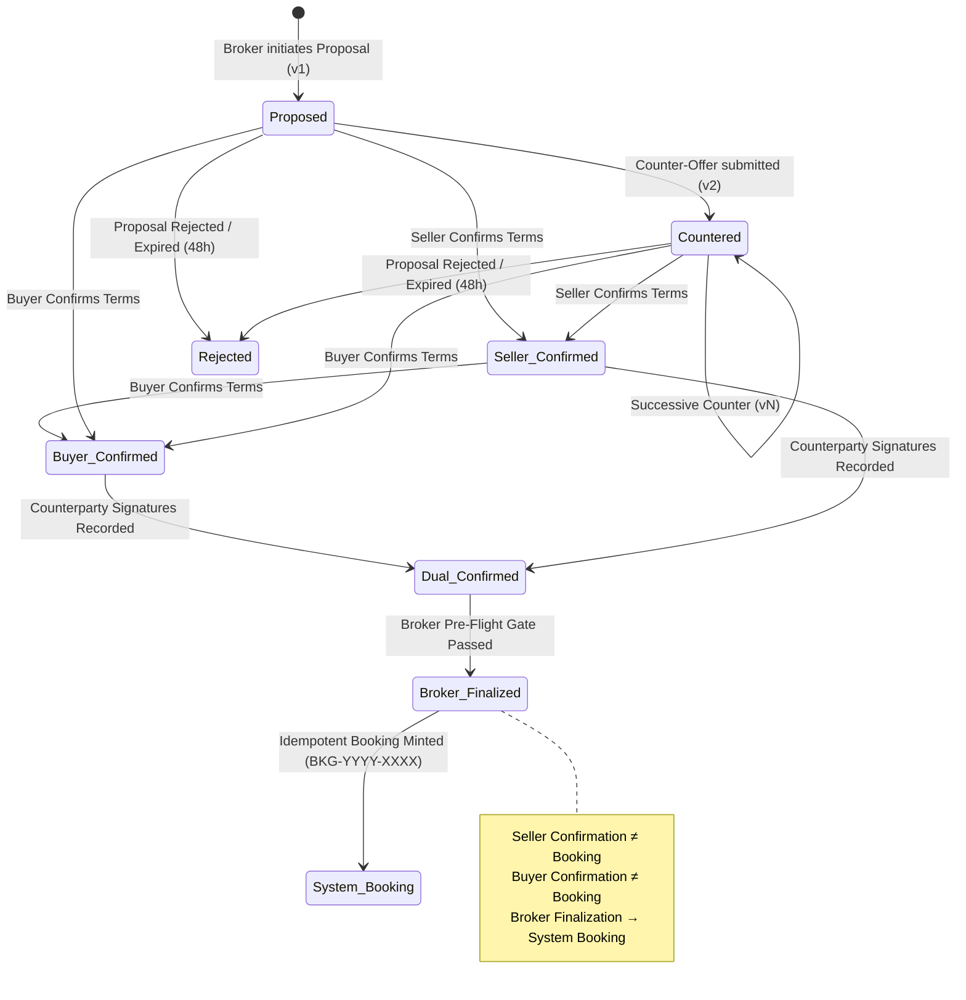
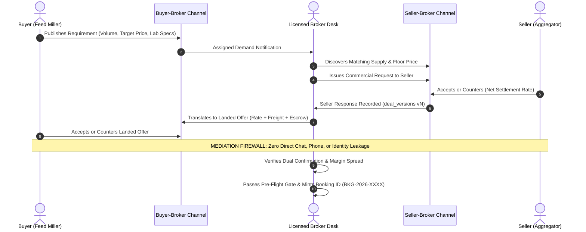
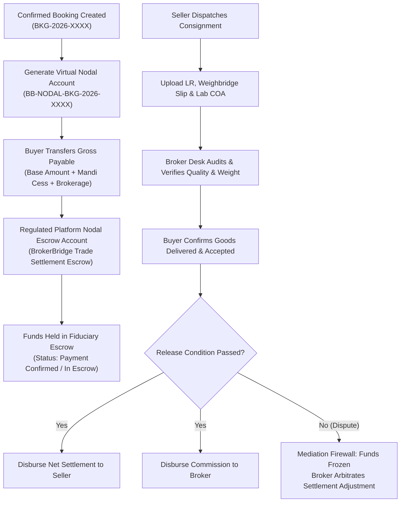

# TECHNICAL ARCHITECTURE REPORT

**Document Reference:** `project-audit/04_TECHNICAL_ARCHITECTURE.md`  
**Date of Audit:** October 17, 2026  
**Auditor:** Senior Software Architect & Technical Systems Auditor  
**Project:** BrokerBridge Enterprise & VetKind Animal Health India  

---

## 1. Architectural Overview & System Topology

BrokerBridge Enterprise is built on a **modern full-stack TypeScript architecture** leveraging Next.js 16 App Router with Turbopack, React 19, Tailwind CSS v4, Drizzle ORM, and Supabase (PostgreSQL DBaaS, SSR Authentication, and Private Storage).

The application operates as a **federated, multi-role marketplace operating system** governed by strict data isolation, zero-trust server validations, immutable legal versioning, and a disintermediation firewall.

```mermaid
graph TB
    subgraph ClientLayer ["Client Layer (Mobile-First 360px Baseline)"]
        MobileNav["Fixed Mobile Navigation<br>(48px Touch Targets)"]
        BuyerUI["Buyer Workspace<br>Ocean Blue (#0284C7)"]
        SellerUI["Seller Command Center<br>Forest Emerald (#059669)"]
        BrokerUI["Broker Trading Desk<br>Electric Teal (#0D9488)"]
        AdminUI["Admin Governance Desk<br>Indigo Slate (#4F46E5)"]
        VetKindUI["VetKind Animal Health Portal<br>Emerald (#10B981)"]
    end

    subgraph SecurityEdge ["Edge Security & Routing Layer"]
        Middleware["Next.js Edge Middleware<br>(JWT Claim Verification & RBAC Routing)"]
        SessionManager["@supabase/ssr Cookie Session Manager<br>(httpOnly, sameSite: lax)"]
        PIIScrubber["Zero-PII Regex Scrubber & Firewall<br>(Phone, Email, GSTIN, Minimum Floor)"]
    end

    subgraph ServerLayer ["Next.js Server Actions & Application Services"]
        ServerActions["68 Server Action Suites<br>(Tenant Ownership & F12 Tamper Defense)"]
        DiffEngine["Visual Diff Engine<br>(Predecessor Snapshot Comparison)"]
        MatchEngine["Deterministic 6-Factor AI Match Engine<br>(Commodity 35%, Grade 25%, Price 20%, ...)"]
        NotificationQueue["Notification Queue Engine<br>(SKIP LOCKED Atomic Claiming, Backoff)"]
        PDFEngine["Server-Side PDF Renderer<br>(@react-pdf/renderer)"]
    end

    subgraph DataLayer ["Database & Infrastructure Layer"]
        DrizzleORM["Drizzle ORM v0.45.2<br>(32 Core Tables + 4 VetKind Tables)"]
        PostgreSQL["Supabase PostgreSQL 15+<br>(Immutability DB Triggers & RLS Policies)"]
        StorageVault["Private Supabase Storage Buckets<br>(15-Min Time-Limited Signed URLs)"]
    end

    ClientLayer --> SecurityEdge
    SecurityEdge --> ServerLayer
    ServerLayer --> DataLayer
```



---

## 2. Frontend Architecture & Design Standards

### 2.1 Route Topology (Next.js 16 App Router)
The application organizes functionality into isolated route groups protected by role-enforcing middleware:
- `app/(buyer)/buyer/`: Enterprise Buyer Workspace.
  - `/buyer`: Procurement Command Center (KPI summary ribbon, P0 Action Feed).
  - `/buyer/requirements`: 6-step requirement wizard and demand feed.
  - `/buyer/proposals`: Proposal inbox with net landed rate breakdowns and version timeline.
  - `/buyer/deals/[id]`: Visual diff review screen and confirmation gate.
  - `/buyer/orders`: Orders hub, partial fulfillment visualizer, logistics timeline, and document vault.
  - `/buyer/more`: Nodal payable ledger and dispute exception tracker.
- `app/(seller)/seller/`: Seller Command Center.
  - `/seller`: Inventory dashboard, loading readiness status, and active supply contract feed.
  - `/seller/requests`: Broker Request Inbox with Accept/Reject/Counter triad.
  - `/seller/deals/[id]`: Deal snapshot confirmation and booking tracking.
  - `/seller/dispatch`: Dispatch execution, partial shipment math, and document uploads.
  - `/seller/payments`: Financial settlement overview and net receivables ledger.
- `app/(broker)/broker/`: Broker Lite Trading Desk.
  - `/broker`: Action-First home with 4-card KPI ribbon and follow-up task feed.
  - `/broker/work`: Buyer requirement mandates and contextual supply discovery.
  - `/broker/deals`: Deal builder, dual-channel negotiation, and booking finalization gate.
  - `/broker/orders`: Order operations, logistics tracker, and transit exception monitoring.
  - `/broker/more`: Commission ledger, lightweight CRM contact cards, and dispute arbitration center.
- `app/(admin)/admin/`: Platform Administration.
  - `/admin`: Master data CRUD, company KYC verification queue, and deal desk oversight.
- `app/(vetkind)/vetkind/`: VetKind Animal Health India Portal.
  - `/vetkind`: Product catalog, veterinary formulations, and therapeutic segments.
  - `/vetkind/dealers`: Authorized dealer locator and commercial dealership application.

### 2.2 Tier-2 Indian Market UX Standards
The user interface adheres to strict ergonomics tailored for non-technical users in agricultural mandi hubs:
1. **360px Mobile-First Baseline:** All screens are designed and validated for a 360px screen width first. Containers enforce `w-full max-w-full overflow-x-hidden`.
2. **48px Minimum Touch Targets:** All interactive elements (buttons, inputs, dropdown selectors, checkboxes) enforce `min-h-[48px] h-12` touch zones to prevent mis-clicks.
3. **Zero Data-Wall Standard:** Dense, non-responsive desktop HTML `<table>` elements are strictly prohibited on primary mobile screens. Data is presented using stacked cards, visual chips, progress bars, and responsive flex layouts. Where tables are necessary (e.g. Admin or Global Payables), they are wrapped in `overflow-x-auto min-w-full` touch-pan containers.
4. **Distinct Persona Color Palettes:**
   - **Buyer:** Ocean Blue (`#0284C7`)
   - **Seller:** Forest Emerald (`#059669`)
   - **Broker:** Electric Teal (`#0D9488`)
   - **Admin:** Indigo Slate (`#4F46E5`)
   - **VetKind:** Botanical Emerald (`#10B981`)

---

## 3. Backend Architecture & Security Infrastructure

### 3.1 Edge Authentication & Middleware Pipeline
Next.js Edge Middleware (`middleware.ts`) intercepts every request:
1. Derives authenticated session via `@supabase/ssr` using `httpOnly: true`, `secure: true` (in production), and `sameSite: 'lax'` cookie flags.
2. Extracts verified JWT claims (`role`, `company_id`).
3. Protects against infinite redirect loops by inspecting pathnames and validating authorization before redirection.
4. Redirects unauthorized role attempts immediately to `/login?error=unauthorized`.

### 3.2 "F12 Inspect" Defense in Server Actions
Client-side parameter tampering is mathematically eliminated. Across all 68 Server Action suites in `src/server/actions/`:
- User identity (`user.id`), assigned role (`user.role`), and tenant organization (`user.company_id`) are **never accepted as parameters from the client**.
- Every action re-authenticates the session on the server via `verifyBuyerSession()` or `@supabase/ssr` and derives organization IDs directly from PostgreSQL.
- Mutations strictly verify tenant ownership before executing updates:
  ```typescript
  // Canonical Server Action Tenant Verification Pattern
  const session = await verifyBuyerSession();
  const [deal] = await db.select().from(deals).where(
    and(
      eq(deals.id, dealId),
      or(eq(deals.buyerId, session.companyId), eq(requirements.companyId, session.companyId))
    )
  );
  if (!deal) throw new Error("UNAUTHORIZED: Tenant organization mismatch");
  ```

---

## 4. State Machines & Core Operational Workflows

### 4.1 Deal Negotiation & Immutability State Machine
Every commercial negotiation round increments `deal_versions` with an immutable JSONB snapshot. Overwriting historical records is blocked at the database level by PostgreSQL triggers.



### 4.2 The "Mediation Firewall" Architecture
Direct counterparty interaction is completely prohibited to preserve broker business value and protect counterparties from harassment or fraud.



### 4.3 Nodal Escrow Settlement Architecture
Direct bank transfers between Buyer and Seller are disallowed. Payments are routed through a regulated nodal trade settlement account with virtual account mapping.



---

## 5. Third-Party Integrations & External Services

| Service | Integration Point | Technical Implementation | Fallback / Resilience Strategy |
| :--- | :--- | :--- | :--- |
| **Supabase Auth** | Session Authentication | `@supabase/ssr` with httpOnly cookies | Edge middleware handles expired tokens gracefully without loops |
| **Supabase DBaaS** | Core Relational Data | Drizzle ORM connecting to PostgreSQL | Connection pooling via Supabase transaction pooler (port 6543) |
| **Supabase Storage** | Private Document Vault | `@supabase/supabase-js` storage API | 15-minute time-limited signed URLs; strict path traversal sanitization |
| **Meta WhatsApp API** | Notification Webhooks | `app/api/webhooks/whatsapp/route.ts` | Development mock queue; exponential retry backoff on delivery failure |
| **Google Gemini AI** | Document OCR / Extraction | `@google/generative-ai` SDK | Fallback to manual laboratory parameter entry if API rate-limited |
| **Vercel Cron** | Scheduled Tasks | `app/api/cron/` with `CRON_SECRET` | Header-authenticated cron jobs for auto-expiry and dispatch monitoring |
