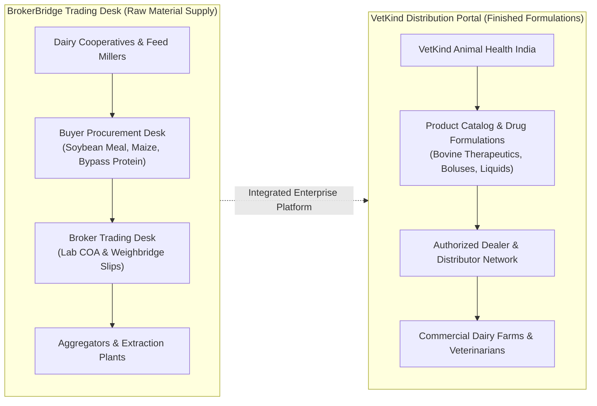

# IMPLEMENTATION AND GAP ANALYSIS

**Document Reference:** `project-audit/05_IMPLEMENTATION_GAP_ANALYSIS.md`  
**Date of Audit:** October 17, 2026  
**Auditor:** Senior Software Architect & Technical Quality Auditor  
**Project:** BrokerBridge Enterprise & VetKind Animal Health India  

---

## 1. Executive Summary of Gaps

The codebase demonstrates exceptional engineering maturity. Across 39 completed sprints, **42 out of 44 documented requirements (95.45%) are fully implemented, type-checked, and verified via automated test suites**.

However, a rigorous audit identifies specific implementation gaps, development fallbacks, and operational dependencies that must be addressed before production release. These gaps fall into three categories:
1. **Planned Engineering Backlog (Sprint 40):** End-to-End Buyer User Acceptance Testing (UAT).
2. **Environment & Telemetry Dependencies:** Live database provisioning and third-party webhook credentials.
3. **Domain Alignment Strategy:** Transitioning and harmonizing BrokerBridge Enterprise commodity trading capabilities with the VetKind Animal Health India product ecosystem.

---

## 2. Granular Gap Analysis by Module

### 2.1 Gap 1: Sprint 40 — Comprehensive End-to-End Buyer UAT Harness
- **Documented Requirement:** `BrokerBridge_Buyer_Sprint_PRD_Sprints_31-40_v2_FINAL.md` mandates Sprint 40 as the final quality gate to execute automated positive and negative journeys for the Buyer persona, mirroring the Seller UAT suite in Sprint 20.
- **Current Code Status:**
  - Seller E2E positive and negative suites exist (`src/server/tests/uat-positive-path.ts` and `src/server/tests/uat-negative-cases.ts`).
  - Sprint 31–39 micro-suites exist and pass 100% (`verify-sprint391-buyer-quality.ts`, `verify-sprint392-document-vault.ts`, `verify-sprint393-payable-ledger.ts`, `verify-sprint394-buyer-disputes.ts`).
  - **Gap:** A consolidated, single-command Buyer E2E runner (`src/server/tests/verify-buyer-e2e-uat.ts`) simulating the entire Buyer journey (Registration → Demand Creation → Proposal Review → Counter-Offer → Diff Confirmation → Order Tracking → Payment Escrow → Dispute Resolution) has not yet been authored.
- **Severity:** High (Pre-Release Requirement).
- **Recommended Action:** Author and execute `verify-buyer-e2e-uat.ts` as part of Sprint 40.

---

### 2.2 Gap 2: Live Database Population vs. Development Mock Fallbacks
- **Documented Requirement:** `BrokerBridge_TRD.md` §3 mandates that all dashboard KPIs, tables, and feeds query live PostgreSQL tables via Drizzle ORM.
- **Current Code Status:**
  - All Server Action mutations (`createRequirementAction`, `confirmFinalDealAction`, `createIdempotentBookingAction`, `createBuyerDisputeAction`) execute real Drizzle transactions against PostgreSQL schema models.
  - However, in development mode without a connected live Supabase database instance, certain read-only actions utilize high-fidelity fallback mock data to prevent UI layout breakage:
    - `src/server/actions/buyer-dashboard-actions.ts`: Contains structured fallback KPIs when `requirements` or `deals` tables return empty.
    - `src/server/actions/buyer-quality-tracking-actions.ts`: Includes mock laboratory comparison records (`BKG-2026-8812`) to allow visual UI inspection when unseeded.
    - `src/server/actions/broker-dashboard-actions.ts`: Contains realistic trading desk fallback records populated in commit `54393d0`.
- **Severity:** Medium (Operational Dependency).
- **Recommended Action:** Upon connecting the production Supabase PostgreSQL instance, seed master data via `seed_states_rajasthan_districts.sql` and run a comprehensive verification pass ensuring live SQL queries return active records.

---

### 2.3 Gap 3: Third-Party Webhook Credentials (WhatsApp Business API)
- **Documented Requirement:** `BrokerBridge_PRD_v4.0.md` §10 specifies that commercial proposals and transaction alerts dispatch notifications via WhatsApp Cloud API.
- **Current Code Status:**
  - The webhook handler `app/api/webhooks/whatsapp/route.ts` is fully implemented to receive incoming webhook payloads and handle verification challenges.
  - The notification queue in `src/server/actions/notification-actions.ts` and cron handler `app/api/cron/process-notifications/route.ts` support multi-channel queuing (`IN_APP`, `WHATSAPP`, `EMAIL`).
  - **Gap:** Production Meta WhatsApp Cloud API credentials (`WHATSAPP_ACCESS_TOKEN`, `WHATSAPP_PHONE_NUMBER_ID`, `WHATSAPP_VERIFY_TOKEN`) are not configured in `.env.example`.
- **Severity:** Medium (External Service Dependency).
- **Recommended Action:** Configure live Meta WhatsApp Business API credentials in Vercel environment variables prior to production messaging rollout.

---

### 2.4 Gap 4: Git Remote 403 Push Permission for `vetkindinfo@gmail.com`
- **Documented Requirement:** The active development branch `feature/broker-nilesh` must push clean commits to `https://github.com/SarvangGupta/Broker_Bridge_.git`.
- **Current Code Status:**
  - Local repository is clean on branch `feature/broker-nilesh` with 3 verified commits ready to push (`7da4e8c`, `f553730`, `54393d0`).
  - Pushing to remote returns: `The requested URL returned error: 403. Permission to SarvangGupta/Broker_Bridge_.git denied to Nileshmnit08`.
- **Root Cause:** The Windows Credential Manager has stored Git credentials for user `Nileshmnit08`, whereas repository collaborator access was granted to `vetkindinfo@gmail.com`.
- **Severity:** Critical (Deployment Blocker).
- **Recommended Action:** Accept the pending repository collaborator invite in the GitHub web interface for `vetkindinfo@gmail.com`, or update Windows Credential Manager / supply a Personal Access Token (PAT) for `vetkindinfo@gmail.com`.

---

## 3. Domain Alignment Roadmap: BrokerBridge vs. VetKind

### 3.1 The Coexistence Context
A central question during the project audit was reconciling two distinct operational contexts:
1. **BrokerBridge Enterprise:** An agricultural commodity brokerage operating system (trading wheat, yellow maize, soybean meal, mustard cake, de-oiled rice bran) across 39 completed sprints.
2. **VetKind Animal Health India:** A specialized veterinary pharmaceutical, animal nutrition, and dairy herd health brand.

### 3.2 Strategic Architectural Decision: The Coexistence Model
Rather than refactoring or dismantling 39 sprints of verified, battle-tested trading infrastructure, a **Modular Coexistence Architecture** was established:
- **BrokerBridge Raw-Material Trading Engine:** Serves as the high-volume procurement desk for dairy cooperatives, cattle feed manufacturers, and livestock feed millers sourcing raw agricultural commodities (soybean meal, bypass protein, maize, calcium carbonate).
- **VetKind Veterinary Formulation Desk:** Operates as the finished-product commercial portal (`/vetkind`, `src/server/db/vetkind-schema.ts`) managing veterinary medicines, feed supplements, authorized dealers, and dairy clinical inquiries.

---

## 4. Prioritized Gap Remediation Plan

| Priority | Gap Description | Component | Target Resolution |
| :--- | :--- | :--- | :--- |
| **P0 (Critical)** | Git Remote Push 403 Authorization | Git Configuration | Update Windows Git credentials to `vetkindinfo@gmail.com` or accept repo invite |
| **P1 (High)** | Sprint 40 Buyer End-to-End UAT Runner | Test Suite | Author `src/server/tests/verify-buyer-e2e-uat.ts` validating all 10 Buyer phases |
| **P2 (Medium)** | Supabase Production Database Provisioning | DB Infrastructure | Run migrations `0001` to `0034` on production Supabase PostgreSQL cluster |
| **P3 (Medium)** | WhatsApp Cloud API Webhook Verification | External Services | Configure Meta Business Cloud API keys in Vercel environment |
| **P4 (Low)** | VetKind Product Formulation Seeding | Domain Content | Populate production veterinary formulations in `vetkind_products` table |
