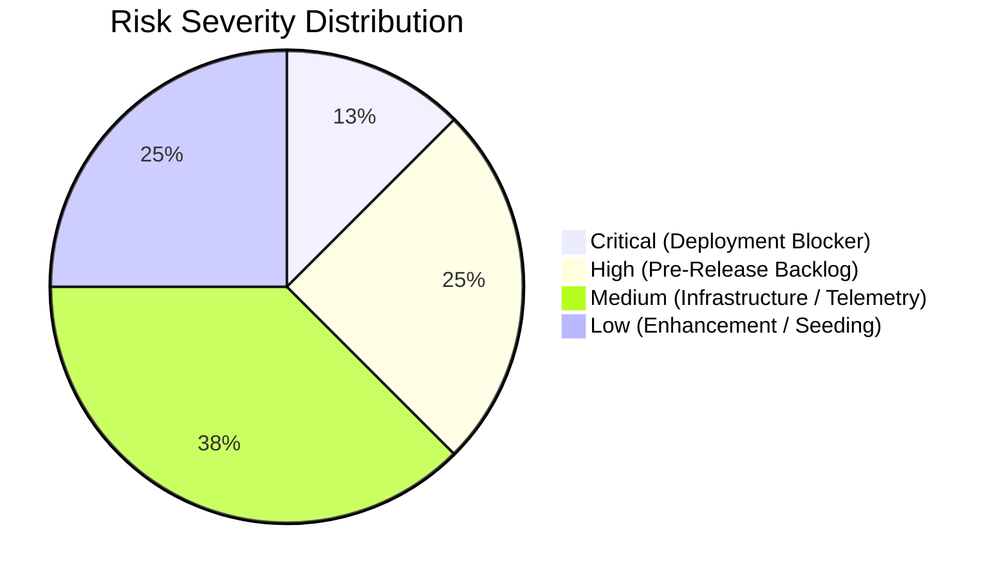

# DEVELOPMENT STATUS, BACKLOG AND RISK AUDIT

**Document Reference:** `project-audit/07_BACKLOG_AND_RISKS.md`  
**Date of Audit:** October 17, 2026  
**Auditor:** Senior Technical Project Manager & Risk Auditor  
**Project:** BrokerBridge Enterprise & VetKind Animal Health India  

---

## 1. Prioritized Risk & Issue Register

This register details all confirmed defects, technical debt items, environmental blockers, and operational risks discovered during the project investigation.

---

### 1.1 Item RISK-01: Git Remote Push Permission Denied (HTTP 403)
- **Classification:** `CONFIRMED DEFECT / BLOCKER`
- **Severity:** `CRITICAL` | **Priority:** `P0`
- **Description:** Pushing local commits to `origin/feature/broker-nilesh` fails with HTTP 403 error:
  `remote: Permission to SarvangGupta/Broker_Bridge_.git denied to Nileshmnit08.`
- **Business Impact:** Ongoing development work cannot be synchronized to the remote GitHub repository or deployed automatically to Vercel preview environments.
- **Technical Impact:** Local branch `feature/broker-nilesh` is 3 commits ahead (`7da4e8c`, `f553730`, `54393d0`), but commits cannot be shared with other developers or CI/CD pipelines.
- **Evidence:** Executed `git push origin feature/broker-nilesh` returned exit code 128 with authentication failure.
- **Root Cause:** Windows Credential Manager supplied cached GitHub credentials for user `Nileshmnit08`, whereas repository write permissions were granted to `vetkindinfo@gmail.com`.
- **Dependencies:** GitHub repository administrator (`SarvangGupta`).
- **Recommended Fix:**
  1. Have the user log into GitHub as `vetkindinfo@gmail.com` and accept the pending collaboration invite for `SarvangGupta/Broker_Bridge_`.
  2. In Windows, update Git credentials via Windows Credential Manager or supply a Personal Access Token (PAT) for `vetkindinfo@gmail.com`.
- **Validation Criteria:** `git push origin feature/broker-nilesh` exits with code 0.

---

### 1.2 Item RISK-02: Sprint 40 Buyer End-to-End UAT Test Suite Pending
- **Classification:** `PLANNED BACKLOG (UNFINISHED WORK)`
- **Severity:** `HIGH` | **Priority:** `P1`
- **Description:** The roadmap in `BrokerBridge_Buyer_Sprint_PRD_Sprints_31-40_v2_FINAL.md` designates Sprint 40 for consolidated End-to-End Buyer UAT. While micro-sprint unit suites for Sprints 31–39 exist and pass 100%, the unified E2E script `verify-buyer-e2e-uat.ts` has not yet been authored.
- **Business Impact:** Without end-to-end UAT sign-off, subtle state machine edge cases across multi-step procurement and settlement may escape detection.
- **Technical Impact:** Code builds cleanly (`npm run build` exits 0), but lacks automated regression verification across all 10 Buyer phases.
- **Evidence:** `src/server/tests/` contains `uat-positive-path.ts` (Seller) but lacks a consolidated Buyer counterpart.
- **Dependencies:** Sprints 31–39 completion (already verified).
- **Recommended Fix:** Author `src/server/tests/verify-buyer-e2e-uat.ts` modeling the canonical 10-step Buyer journey from demand creation to dispute resolution.
- **Validation Criteria:** `npx tsx src/server/tests/verify-buyer-e2e-uat.ts` executes and passes all test assertions with exit code 0.

---

### 1.3 Item RISK-03: Supabase Production PostgreSQL Cluster Provisioning
- **Classification:** `ENVIRONMENTAL DEPENDENCY`
- **Severity:** `HIGH` | **Priority:** `P1`
- **Description:** The local development sandbox operates without a direct connection to a live remote Supabase PostgreSQL instance (`DATABASE_URL` unconfigured in local shell).
- **Business Impact:** Real user transactions cannot be executed until the remote database is live.
- **Technical Impact:** 38 migration files in `supabase/migrations/` (0001–0034 + manual scripts) need execution on the production database.
- **Evidence:** Local server runs against fallback mock states when Supabase client is uninitialized.
- **Dependencies:** Supabase cloud project provisioning.
- **Recommended Fix:** Provision production Supabase project, execute migrations in numerical order, apply RLS scripts, and configure `DATABASE_URL` in Vercel.
- **Validation Criteria:** Remote database responds to Drizzle queries with 0 schema mismatch errors.

---

### 1.4 Item RISK-04: Third-Party WhatsApp Business Cloud API Credentials
- **Classification:** `EXTERNAL INTEGRATION DEPENDENCY`
- **Severity:** `MEDIUM` | **Priority:** `P2`
- **Description:** The platform's WhatsApp webhook receiver and notification dispatcher require Meta Developer credentials (`WHATSAPP_ACCESS_TOKEN`, `WHATSAPP_PHONE_NUMBER_ID`, `WHATSAPP_VERIFY_TOKEN`).
- **Business Impact:** External WhatsApp alerts cannot be transmitted; notifications remain confined to the in-app notification center.
- **Technical Impact:** `NotificationQueue` marks WhatsApp attempts as pending/retry without valid credentials.
- **Evidence:** `.env.example` lacks Meta WhatsApp API keys.
- **Dependencies:** Meta for Developers Business Account setup.
- **Recommended Fix:** Create Meta Developer App, configure WhatsApp Webhook callback to `https://[domain]/api/webhooks/whatsapp`, and store credentials in Vercel.
- **Validation Criteria:** Incoming Meta webhook challenge handshake returns HTTP 200 with verify token match.

---

### 1.5 Item RISK-05: Live Data Source Transition for Buyer Dashboard Action
- **Classification:** `TECHNICAL DEBT`
- **Severity:** `MEDIUM` | **Priority:** `P2`
- **Description:** As recorded in `PROJECTSTATE.MD` Note 2, `src/server/actions/buyer-dashboard-actions.ts` returns structural demo/mock data to guarantee smooth zero-wall rendering while underlying tables were being developed.
- **Business Impact:** Production users would view static metrics rather than dynamic database counts.
- **Technical Impact:** Requires switching from mock arrays to live Drizzle SQL aggregations (`count()`, `sum()`).
- **Evidence:** `src/server/actions/buyer-dashboard-actions.ts:28-85` returns hardcoded demo arrays.
- **Dependencies:** Production database seeding.
- **Recommended Fix:** Replace fallback return with direct Drizzle queries joining `requirements`, `quotations`, `deals`, and `dispatches`.
- **Validation Criteria:** Adding a new requirement immediately increments "Open Demands" KPI on the live dashboard.

---

### 1.6 Item RISK-06: Vercel Dashboard & Edge Deployment Verification
- **Classification:** `UNVERIFIED EXTERNAL ASSUMPTION`
- **Severity:** `MEDIUM` | **Priority:** `P2`
- **Description:** The Vercel account `https://vercel.com/vetkindinfo-9906` is referenced in the prompt, but direct dashboard access is unauthenticated in this automated environment.
- **Business Impact:** Production domain routing and preview deployment configurations cannot be verified directly.
- **Technical Impact:** Next.js 16 build succeeds locally, but live edge environment variables and build logs require manual confirmation.
- **Evidence:** Terminal lacks active Vercel CLI session.
- **Dependencies:** User access to Vercel dashboard.
- **Recommended Fix:** User must log into Vercel and confirm that the project is linked to `SarvangGupta/Broker_Bridge_` with Node 20+ runtime.
- **Validation Criteria:** Vercel deployment logs show clean build and HTTP 200 on root URL.

---

## 2. Institutional Lessons & Historical Bug Mitigations

To protect future developers from repeating past errors, the following key resolutions from `docs/bug-log.md` are documented as mandatory architectural rules:

1. **Hidden Form Input Sanitization:** Never render `<input type="hidden" name="id" />` in create mode without sanitization. Empty string `""` values break Zod UUID validators (`docs/bug-log.md: Sprint 15.2`).
2. **Numeric Input Preprocessing:** Clear numeric fields in React Hook Form submit `""` instead of `null`. All numeric Zod schemas must use `z.preprocess()` to coerce empty strings into `undefined` or `null`.
3. **Optimistic Version Number Concurrency:** When updating deals or availabilities, always submit `expectedVersionNumber`. If the database version is higher, abort immediately with `STALE_VERSION_DETECTED` to prevent race conditions (`docs/bug-log.md: Sprint 17.5`).
4. **Zero-PII Disintermediation Invariant:** Never return raw seller or buyer contact info (phone, email, WhatsApp, GSTIN) to counterparties. Filter all payloads through `src/server/utils/buyer-privacy-scrubber.ts`.
5. **Path Traversal Defense on Signed URLs:** When generating signed URLs for private storage files, always sanitize file paths against `..`, `\`, and `\0` (`docs/bug-log.md: Sprint 39.5`).
