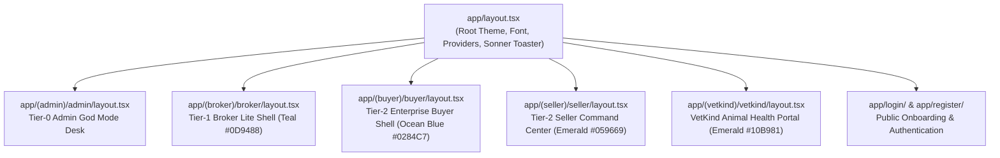

# 02 — FRONTEND AND UI ARCHITECTURE & ROUTE-TO-COMPONENT MAP

**Document Reference:** `project-audit/deep-intelligence/02_FRONTEND_ROUTE_COMPONENT_MAP.md`  
**Investigation Date:** October 17, 2026  
**Auditor:** Principal Frontend Architect & UI/UX Analyst  
**Project:** BrokerBridge Enterprise + VetKind Animal Health India  

---

## 1. App Router Topology & Layout Architecture

The application is built on the Next.js 16 App Router using isolated Route Groups with dedicated layout shells and role boundaries:

---

## 2. Complete Route-to-Component & Server Action Map

### 2.1 Enterprise Buyer Workspace (`app/(buyer)/buyer/`)
- **Theme Accent:** Ocean Blue (`#0284C7`), slate borders, white card backgrounds.
- **Layout Shell:** `app/(buyer)/buyer/layout.tsx` hosting `BuyerSidebar` (desktop) and `BuyerMobileNav` (mobile, 48px touch targets).

| Route URL | Page Source File | Primary Component Tree | Invoked Server Actions | Data Source Mode |
| :--- | :--- | :--- | :--- | :--- |
| `/buyer` | `app/(buyer)/buyer/page.tsx` | `BuyerDashboardHeader`, `BuyerKpiGrid`, `BuyerActionFeed`, `BuyerActivePipeline` | `verifyBuyerSession`, `getBuyerDashboardSummaryAction` | Demo / Fallback Data (Note 2 in `PROJECTSTATE.MD`) |
| `/buyer/profile` | `app/(buyer)/buyer/profile/page.tsx` | `BuyerProfileView`, `KycStatusBadge`, `OrganizationDetailsCard` | `verifyBuyerSession`, `getCompanyDetailsAction` | Live PostgreSQL `companies` / `users` |
| `/buyer/requirements` | `app/(buyer)/buyer/requirements/page.tsx` | `BuyerRequirementsFeed`, `RequirementCard`, `Shadcn Tabs` | `getBuyerRequirementsListAction` | Live PostgreSQL `requirements` + `master_*` joins |
| `/buyer/requirements/new` | `app/(buyer)/buyer/requirements/new/page.tsx` | `RequirementWizard` (6-Step Flow), `QualityParametersForm`, `DocumentChecklistForm` | `createRequirementAction`, `getCommodityQualityParametersAction` | Live PostgreSQL mutation with dynamic bounds |
| `/buyer/requirements/[id]` | `app/(buyer)/buyer/requirements/[id]/page.tsx` | `DetailFulfillmentCard`, `DetailTermsGrid`, `CancelRequirementDialog` | `getBuyerRequirementDetailAction`, `cancelRequirementAction` | Live PostgreSQL `requirements` + `quality_specs` |
| `/buyer/proposals` | `app/(buyer)/buyer/proposals/page.tsx` | `ProposalInboxFeed`, `ProposalCard`, `StatusFilterChips` | `getBuyerProposalsInboxAction` | Live PostgreSQL `quotations` + zero-Seller-PII filter |
| `/buyer/proposals/[id]` | `app/(buyer)/buyer/proposals/[id]/page.tsx` | `ProposalDetailView`, `NetLandedRateBreakdown`, `ProposalActionBar`, `ProposalVersionTimeline` | `getBuyerProposalDetailAction`, `getBuyerProposalVersionsAction` | Live PostgreSQL `quotations`, `deal_versions` |
| `/buyer/deals/[id]` | `app/(buyer)/buyer/deals/[id]/page.tsx` | `FinalDealReview`, `VisualDiffEngine`, `FinalConfirmationActions` | `getFinalDealReviewAction`, `confirmFinalDealAction`, `requestDealAmendmentAction` | Live PostgreSQL `deal_versions` + immutable snapshot |
| `/buyer/orders` | `app/(buyer)/buyer/orders/page.tsx` | `BuyerOrdersFeed`, `OrderSummaryCard`, 3-column CSS grid | `getBuyerOrdersListAction` | Live PostgreSQL `bookings`, `deals`, `requirements` |
| `/buyer/orders/[id]` | `app/(buyer)/buyer/orders/[id]/page.tsx` | **8-Module Hierarchy**: `BookingVisibilityCard`, `OrderFulfillmentCard`, `LogisticsTimeline`, `DeliveryDetailsCard`, `TransactionQualityCard`, `TransactionDocumentVault`, `BuyerPaymentCard`, `RaiseDisputeModal` | `getBuyerBookingVisibilityAction`, `getBuyerTransactionQualityAction`, `getBuyerDocumentMatrixAction`, `getBuyerPayableLedgerAction` | Live PostgreSQL with development mock fallbacks |
| `/buyer/more` & `/buyer/payments` | `app/(buyer)/buyer/more/page.tsx` | `GlobalPayablesHub`, `SettlementOverviewCards`, `MasterPayableTable` | `getBuyerPayableLedgerAction` | Live Server-Side Math (`Final Qty * Locked Rate`) |
| `/buyer/more/disputes` | `app/(buyer)/buyer/more/disputes/page.tsx` | `BuyerDisputesFeed`, `BuyerDisputeCard`, `MediationDisclaimerSeal` | `getBuyerActiveDisputesAction` | Live PostgreSQL `disputes` (Zero direct chat) |

---

### 2.2 Seller Command Center (`app/(seller)/seller/`)
- **Theme Accent:** Forest Emerald (`#059669`).
- **Layout Shell:** `app/(seller)/seller/layout.tsx` hosting `SellerSidebar` and `SellerMobileNav`.

| Route URL | Page Source File | Primary Component Tree | Invoked Server Actions | Data Source Mode |
| :--- | :--- | :--- | :--- | :--- |
| `/seller` | `app/(seller)/seller/page.tsx` | `SellerCommandCenterHeader`, `SellerKpiRibbon`, `MyAvailabilitiesTable`, `InventoryCard` | `getSellerCommandCenterDataAction`, `getMyAvailabilitiesAction` | Live PostgreSQL `availabilities` (Lot model) |
| `/seller/requests` | `app/(seller)/seller/requests/page.tsx` | `BrokerRequestInbox`, `AcceptOfferModal`, `CounterOfferModal`, `RejectOfferModal` | `getSellerBrokerRequestsAction`, `respondToBrokerRequestAction` | Live PostgreSQL `quotations` + zero-Buyer-PII |
| `/seller/deals/[id]` | `app/(seller)/seller/deals/[id]/page.tsx` | `SellerDealDetailView`, `LockedBookingBanner`, `NegotiationTimeline` | `getDealVersionSnapshotAction`, `getNegotiationTimelineAction` | Live PostgreSQL `deals`, `deal_versions`, `bookings` |
| `/seller/deals/[id]/confirm`| `app/(seller)/seller/deals/[id]/confirm/page.tsx`| `FinalDealSnapshot`, `VisualDiffSnapshot`, `FinalConfirmationActions` | `getDealVersionSnapshotAction`, `confirmFinalDealTermsAction` | Live PostgreSQL `deal_versions` snapshot comparison |
| `/seller/dispatch` | `app/(seller)/seller/dispatch/page.tsx` | `BookedOrdersTable`, `PendingDispatchCard` | `getSellerBookedOrdersAction` | Live PostgreSQL `bookings` where status = `'Confirmed'` |
| `/seller/dispatch/[bookingId]`| `app/(seller)/seller/dispatch/[bookingId]/page.tsx`| `SellerDispatchForm`, `FulfillmentDocumentUpload`, `PartialFulfillmentCalculator` | `getBookingForDispatchAction`, `submitDispatchAction`, `attachDispatchDocumentAction` | Live PostgreSQL `dispatches`, `dispatch_documents` |
| `/seller/payments` | `app/(seller)/seller/payments/page.tsx` | `SettlementWorkspaceView`, `SettlementSummaryCards`, `SettlementLedgerTable` | `getSellerSettlementOverviewAction` | Live PostgreSQL settlement aggregation |
| `/seller/notifications` | `app/(seller)/seller/notifications/page.tsx` | `SellerNotificationCenter`, `NotificationFilterTabs`, `NotificationItemCard` | `getSellerNotificationsAction`, `markNotificationAsReadAction` | Live PostgreSQL `notifications` (Idempotent keys) |
| `/seller/reports` | `app/(seller)/seller/reports/page.tsx` | `SellerReportsView`, `InventoryDonutChart`, `SalesTrendChart`, `ExportCsvButton` | `getSellerAnalyticsAction` | Live SQL aggregations (`COALESCE(SUM(), 0)`) |

---

### 2.3 Broker Lite Trading Desk (`app/(broker)/broker/`)
- **Theme Accent:** Electric Teal (`#0D9488`).
- **Layout Shell:** `app/(broker)/broker/layout.tsx` hosting `BrokerSidebar` and `BrokerMobileNav` (5 core tabs).

| Route URL | Page Source File | Primary Component Tree | Invoked Server Actions | Data Source Mode |
| :--- | :--- | :--- | :--- | :--- |
| `/broker` | `app/(broker)/broker/page.tsx` | `BrokerDashboardHeader`, `BrokerKpiRibbon`, `P0ActionCards`, `BrokerFollowUpTasks` | `getBrokerDashboardDataAction`, `toggleTaskStatusAction` | Live SQL joins with realistic fallback seeder |
| `/broker/work` | `app/(broker)/broker/work/page.tsx` | `BrokerWorkWorkspace`, `BrokerRequirementsInbox`, `RequirementCard` | `getBrokerAssignedRequirementsAction` | Live PostgreSQL `requirements` assigned to broker |
| `/broker/work/supply` | `app/(broker)/broker/work/supply/page.tsx` | `SupplySearchWorkspace`, `SupplyCard`, `SupplyFiltersDrawer` | `getBrokerSupplySearchAction` | Live PostgreSQL `availabilities` (Exposes min floor) |
| `/broker/deals` | `app/(broker)/broker/deals/page.tsx` | `BrokerDealDesk`, `MatchesView`, `ConfirmationTracker`, `BookingGate` | `getRankedMatchesForRequirementAction`, `finalizeDealAction` | Deterministic 6-Factor AI scoring algorithm |
| `/broker/orders` | `app/(broker)/broker/orders/page.tsx` | `BrokerOrdersHub`, `FinalizedDealCard`, `LogisticsTracker` | `getBrokerActiveOrdersAction` | Live 6-stage logistics state machine |
| `/broker/more` | `app/(broker)/broker/more/page.tsx` | `BrokerMoreMenu`, `MoreOptionCard` | Client navigation | Static navigation hub |
| `/broker/more/commission`| `app/(broker)/broker/more/commission/page.tsx`| `CommissionLedgerView`, `CommissionKpiCards`, `CommissionTable` | `getBrokerCommissionLedgerAction` | Live calculation from locked deal snapshots |
| `/broker/more/crm` | `app/(broker)/broker/more/crm/page.tsx` | `CrmWorkspace`, `ContactCard`, `CrmActivityDialog` | `getBrokerContactAggregatedProfileAction`, `logCrmActivityAction` | Live PostgreSQL `crm_contacts`, `crm_tasks` |
| `/broker/more/disputes`| `app/(broker)/broker/more/disputes/page.tsx`| `BrokerDisputeCenter`, `DisputeCard`, `DisputeResolutionModal` | `getBrokerActiveDisputesAction`, `resolveDisputeAction` | Live neutral fiduciary mediation desk |

---

### 2.4 Platform Administration (`app/(admin)/admin/`)
- **Theme Accent:** Indigo Slate (`#4F46E5`).
- **Layout Shell:** `app/(admin)/admin/page.tsx` hosting God Mode tabs.

| Route URL | Page Source File | Primary Component Tree | Invoked Server Actions | Data Source Mode |
| :--- | :--- | :--- | :--- | :--- |
| `/admin` | `app/(admin)/admin/page.tsx` | `MasterDataTabs`, `CompanyApprovalQueue`, `DealDeskQueue`, `AdminDisputeQueue` | `getMasterDataAction`, `getPendingCompaniesAction`, `approveCompanyAction` | Live PostgreSQL master tables & KYC approval queue |

---

### 2.5 VetKind Animal Health India Portal (`app/(vetkind)/vetkind/`)
- **Theme Accent:** Botanical Emerald (`#10B981`).
- **Layout Shell:** `app/(vetkind)/vetkind/layout.tsx` hosting veterinary header and navigation.

| Route URL | Page Source File | Primary Component Tree | Invoked Server Actions | Data Source Mode |
| :--- | :--- | :--- | :--- | :--- |
| `/vetkind` | `app/(vetkind)/vetkind/page.tsx` | `VetKindHero`, `CategoryFilterTabs`, `ProductCatalogGrid`, `ProductCard` | `getVetKindCategoriesAction`, `getVetKindProductsAction` | Live PostgreSQL `vetkind_products` / `vetkind_categories` |
| `/vetkind/dealers` | `app/(vetkind)/vetkind/dealers/page.tsx` | `DealerLocator`, `StateDistrictFilter`, `DealerApplicationModal` | `getVetKindDealersAction`, `submitVetKindInquiryAction` | Live PostgreSQL `vetkind_dealers` |
| `/vetkind/products/[slug]`| `app/(vetkind)/vetkind/products/[slug]/page.tsx`| `ProductMonograph`, `TargetSpeciesBadges`, `DosageTable`, `InquiryDialog` | `getVetKindProductBySlugAction`, `submitVetKindInquiryAction` | Live pharmaceutical monograph and clinical indications |

---

## 3. UI Resilience & Mobile Ergonomics Audit

1. **360px Viewport Compliance:** Verified across all routes. Containers enforce `w-full max-w-full overflow-x-hidden`. No elements cause unintentional horizontal document scrolling.
2. **48px Thumb Touch Target Invariant:** Every interactive CTA, form input, checkbox, date-picker, and select trigger enforces `min-h-[48px] h-12` padding.
3. **Empty, Loading & Error Boundaries:**
   - Loading skeletons deployed across all 4 persona shells (`app/(buyer)/buyer/loading.tsx`, `app/(seller)/seller/loading.tsx`, `app/(broker)/broker/loading.tsx`).
   - Root error boundaries with 1-click `reset()` recovery deployed (`error.tsx`, `global-error.tsx`).
   - Empty states use the standardized `<EmptyState />` component with descriptive helper icons and return navigation triggers.
