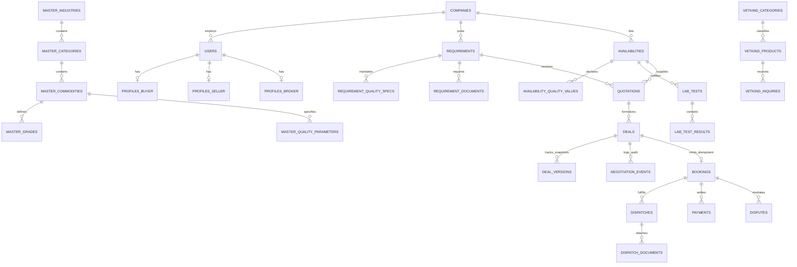

# 04 — DATABASE ARCHITECTURE, DATA LINEAGE & ERD

**Document Reference:** `project-audit/deep-intelligence/04_DATABASE_DICTIONARY_AND_ERD.md`  
**Investigation Date:** October 17, 2026  
**Auditor:** Principal Database Architect & Data Engineer  
**Project:** BrokerBridge Enterprise + VetKind Animal Health India  

---

## 1. Database Entity-Relationship Diagram (Mermaid ERD)

---

## 2. Complete Database Table Dictionary

### 2.1 Identity, Companies & RBAC (5 Tables)
1. **`companies`**: Tenant organization entity.
   - `id`: `uuid` PK, default `gen_random_uuid()`
   - `name`: `text` NOT NULL
   - `gst`: `text` NULL (validated by Zod Indian GST regex)
   - `business_type_id`: `text` NULL
   - `state_id`: `text` NULL
   - `district_id`: `text` NULL
   - `status`: `boolean` NOT NULL DEFAULT `true`
   - `is_verified`: `boolean` NOT NULL DEFAULT `false`
   - `trust_score`: `integer` NOT NULL DEFAULT `100`
2. **`users`**: Platform user identity.
   - `id`: `uuid` PK, references Supabase Auth `auth.users.id`
   - `name`: `text` NOT NULL
   - `mobile`: `text` NULL
   - `email`: `text` NULL
   - `role`: `text` NULL (canonical: `'admin'`, `'broker'`, `'buyer'`, `'seller'`)
   - `status`: `boolean` NOT NULL DEFAULT `true`
   - `company_id`: `uuid` NULL, FK -> `companies.id`
   - `created_at`: `timestamp` NOT NULL DEFAULT `now()`
3. **`profiles_buyer`**: `id` (`uuid` PK, FK -> `users.id`)
4. **`profiles_seller`**: `id` (`uuid` PK, FK -> `users.id`)
5. **`profiles_broker`**: `id` (`uuid` PK, FK -> `users.id`)

### 2.2 Master Data Layer (12 Tables)
6. **`master_business_types`**: `id` (`uuid` PK), `name` (`text` NOT NULL), `status` (`boolean` NOT NULL DEFAULT `true`).
7. **`master_states`**: `id` (`uuid` PK), `name` (`text` NOT NULL), `code` (`text` NULL).
8. **`master_districts`**: `id` (`uuid` PK), `name` (`text` NOT NULL), `state_id` (`uuid` FK -> `master_states.id`).
9. **`master_industries`**: `id` (`uuid` PK), `name` (`text` NOT NULL), `is_active` (`boolean` NOT NULL DEFAULT `true`).
10. **`master_categories`**: `id` (`uuid` PK), `industry_id` (`uuid` FK -> `master_industries.id`), `name` (`text` NOT NULL), `is_active` (`boolean` NOT NULL DEFAULT `true`).
11. **`master_commodities`**: `id` (`uuid` PK), `category_id` (`uuid` FK -> `master_categories.id`), `name` (`text` NOT NULL), `code` (`text` NULL), `status` (`boolean` NOT NULL DEFAULT `true`).
12. **`master_grades`**: `id` (`uuid` PK), `commodity_id` (`uuid` FK -> `master_commodities.id`), `grade_name` (`text` NOT NULL), `parameters` (`jsonb` NULL).
13. **`master_units`**: `id` (`uuid` PK), `name` (`text` NOT NULL), `symbol` (`text` NULL).
14. **`master_packaging_types`**: `id` (`uuid` PK), `name` (`text` NOT NULL), `status` (`boolean` NOT NULL DEFAULT `true`).
15. **`master_quality_parameters`**: `id` (`uuid` PK), `commodity_id` (`uuid` FK -> `master_commodities.id`), `name` (`text` NOT NULL), `type` (`text` NOT NULL: `'numeric'`, `'boolean'`, `'text'`), `unit` (`text` NULL), `min_value` (`numeric` NULL), `max_value` (`numeric` NULL), `target_value` (`numeric` NULL), `is_required` (`boolean` NOT NULL DEFAULT `false`), `is_active` (`boolean` NOT NULL DEFAULT `true`), `created_at` (`timestamp`), `updated_at` (`timestamp`).
16. **`master_laboratories`**: `id` (`uuid` PK), `name` (`text` NOT NULL), `location` (`text` NULL), `is_active` (`boolean` NOT NULL DEFAULT `true`).
17. **`master_vehicle_types`**: `id` (`uuid` PK), `name` (`text` NOT NULL), `status` (`boolean` NOT NULL DEFAULT `true`).

### 2.3 Buyer Demand & Quality Specifications (3 Tables)
18. **`requirements`**: `id` (`uuid` PK), `company_id` (`uuid` FK -> `companies.id`), `commodity_id` (`uuid` FK -> `master_commodities.id`), `grade_id` (`uuid` FK -> `master_grades.id`), `quantity` (`double precision` NOT NULL), `unit_id` (`uuid` FK -> `master_units.id`), `target_price` (`double precision` NOT NULL), `delivery_terms_id` (`text` NOT NULL), `target_date` (`timestamp` NOT NULL), `visibility` (`text` DEFAULT `'global'`), `broker_id` (`uuid` NULL), `status` (`text` DEFAULT `'Open'`), `fulfilled_quantity` (`double precision` DEFAULT `0`), `created_at` (`timestamp`).
19. **`requirement_quality_specs`**: `id` (`uuid` PK), `requirement_id` (`uuid` FK -> `requirements.id` ON DELETE CASCADE), `parameter_id` (`uuid` FK -> `master_quality_parameters.id`), `target_value` (`numeric` NOT NULL), `tolerance` (`numeric` NULL), `created_at` (`timestamp`), `updated_at` (`timestamp`).
20. **`requirement_documents`**: `id` (`uuid` PK), `requirement_id` (`uuid` FK -> `requirements.id` ON DELETE CASCADE), `document_type` (`text` NOT NULL), `is_mandatory` (`boolean` DEFAULT `true`), `created_at` (`timestamp`), `updated_at` (`timestamp`).

### 2.4 Seller Inventory, Lot Model & Lab Records (4 Tables)
21. **`availabilities`**: `id` (`uuid` PK), `company_id` (`uuid` FK -> `companies.id`), `commodity_id` (`uuid` FK -> `master_commodities.id`), `grade_id` (`uuid` FK -> `master_grades.id`), `quantity` (`integer`), `unit_id` (`uuid` FK -> `master_units.id`), `price` (`numeric`), `state_id` (`uuid` FK -> `master_states.id`), `district_id` (`uuid` FK -> `master_districts.id`), `visibility` (`text` DEFAULT `'global'`), `broker_id` (`uuid` NULL), `status` (`text` DEFAULT `'Open'`), `lot_number` (`text` NULL), `total_quantity` (`numeric` NOT NULL), `available_quantity` (`numeric` NOT NULL), `reserved_quantity` (`numeric` DEFAULT `'0'`), `sold_quantity` (`numeric` DEFAULT `'0'`), `minimum_order_quantity` (`numeric` NULL), `asking_price` (`numeric` NOT NULL), `confidential_minimum_price` (`numeric` NULL), `available_from` (`timestamp`), `valid_until` (`timestamp` NOT NULL), `version` (`integer` DEFAULT `1` - Optimistic Concurrency), `loading_status` (`text` DEFAULT `'Not Ready'`), `loading_duration` (`integer` NULL), `loading_start_date` (`timestamp` NULL), `loading_capacity` (`numeric` NULL), `loading_remarks` (`text` NULL), `loading_updated_at` (`timestamp` NULL).
22. **`availability_quality_values`**: `id` (`uuid` PK), `availability_id` (`uuid` FK -> `availabilities.id` ON DELETE CASCADE), `parameter_id` (`uuid` FK -> `master_quality_parameters.id`), `value` (`text` NOT NULL), `source` (`text` DEFAULT `'Seller Declared'`), `verification_status` (`text` DEFAULT `'Pending'`).
23. **`lab_tests`**: `id` (`uuid` PK), `availability_id` (`uuid` FK -> `availabilities.id` ON DELETE CASCADE), `company_id` (`uuid` FK -> `companies.id`), `laboratory_name` (`text` NOT NULL), `laboratory_location` (`text` NULL), `sample_id` (`text` NULL), `sample_date` (`timestamp` NULL), `test_date` (`timestamp` NOT NULL), `report_number` (`text` NOT NULL), `report_date` (`timestamp` NOT NULL), `valid_until` (`timestamp` NULL), `file_url` (`text` NULL), `status` (`text` DEFAULT `'Under Review'`), `verified_by` (`uuid` FK -> `users.id`), `verified_at` (`timestamp` NULL), `verification_notes` (`text` NULL).
24. **`lab_test_results`**: `id` (`uuid` PK), `lab_test_id` (`uuid` FK -> `lab_tests.id` ON DELETE CASCADE), `parameter_id` (`uuid` FK -> `master_quality_parameters.id`), `measured_value` (`text` NOT NULL), `is_within_bounds` (`boolean` DEFAULT `true`).

### 2.5 Quotations, Versioning, Bookings & Negotiations (5 Tables)
25. **`quotations`**: `id` (`uuid` PK), `requirement_id` (`uuid` NOT NULL), `broker_id` (`uuid` NOT NULL), `seller_availability_id` (`uuid` NOT NULL), `offered_price` (`numeric` NOT NULL), `status` (`text` DEFAULT `'Sent'`), `valid_until` (`timestamp` NOT NULL), `counter_price` (`numeric` NULL), `counter_notes` (`text` NULL).
26. **`deals`**: `id` (`uuid` PK), `requirement_id` (`uuid` NOT NULL), `quotation_id` (`uuid` FK -> `quotations.id`), `buyer_id` (`uuid` NOT NULL), `seller_id` (`uuid` NOT NULL), `broker_id` (`uuid` NULL), `agreed_price` (`numeric` NOT NULL), `agreed_quantity` (`double precision` NOT NULL), `status` (`text` DEFAULT `'Dispatch Pending'`), `closed_at` (`timestamp` NULL).
27. **`negotiation_events`**: `id` (`uuid` PK), `request_id` (`uuid` NOT NULL), `company_id` (`uuid` FK -> `companies.id`), `actor_id` (`uuid` FK -> `users.id`), `action_type` (`text` NOT NULL: `'ACCEPT'`, `'REJECT'`, `'COUNTER'`, `'BUYER_FINAL_CONFIRMATION'`, `'AMENDMENT_REQUESTED'`), `payload` (`jsonb` NULL), `created_at` (`timestamp` NOT NULL DEFAULT `now()`).
28. **`deal_versions`**: `id` (`uuid` PK), `request_id` (`uuid` NOT NULL), `version_number` (`integer` NOT NULL), `actor_id` (`uuid` FK -> `users.id`), `status` (`text` DEFAULT `'Proposed'`: `'Draft'`, `'Proposed'`, `'Countered'`, `'Seller Confirmed'`, `'Buyer Confirmed'`, `'Broker Finalized'`, `'Superseded'`), `snapshot_payload` (`jsonb` NOT NULL), `created_at` (`timestamp` NOT NULL DEFAULT `now()`).
29. **`bookings`**: `id` (`uuid` PK), `booking_reference` (`text` UNIQUE NOT NULL), `deal_id` (`uuid` UNIQUE NOT NULL), `locked_version_id` (`uuid` FK -> `deal_versions.id`), `status` (`text` DEFAULT `'Confirmed'`), `created_at` (`timestamp` NOT NULL DEFAULT `now()`).

### 2.6 Dispatches, Documents, Financials & Disputes (5 Tables)
30. **`dispatches`**: `id` (`uuid` PK), `deal_id` (`uuid` FK -> `deals.id`), `seller_id` (`uuid` FK -> `users.id`), `vehicle_type_id` (`uuid` FK -> `master_vehicle_types.id`), `vehicle_number` (`text` NOT NULL), `driver_name` (`text` NOT NULL), `driver_mobile` (`text` NOT NULL), `dispatch_date` (`timestamp` NOT NULL), `expected_delivery_date` (`timestamp` NOT NULL), `status` (`text` DEFAULT `'Dispatched'`).
31. **`dispatch_documents`**: `id` (`uuid` PK), `dispatch_id` (`uuid` FK -> `dispatches.id` ON DELETE CASCADE), `document_type` (`text` NOT NULL: `'LR'`, `'Invoice'`, `'E-Way Bill'`, `'Weighment Slip'`, `'Loading Photo'`), `file_url` (`text` NOT NULL), `uploaded_by` (`uuid` FK -> `users.id`).
32. **`invoices`**: `id` (`uuid` PK), `deal_id` (`uuid` FK -> `deals.id`), `seller_id` (`uuid` FK -> `users.id`), `invoice_no` (`text` NOT NULL), `amount` (`numeric` NOT NULL), `status` (`text` DEFAULT `'Pending'`), `file_url` (`text` NOT NULL).
33. **`payments`**: `id` (`uuid` PK), `deal_id` (`uuid` FK -> `deals.id`), `amount` (`numeric` NOT NULL), `reference_number` (`text` NOT NULL), `status` (`text` DEFAULT `'Confirmed'`).
34. **`disputes`**: `id` (`uuid` PK), `deal_id` (`uuid` FK -> `deals.id`), `filed_by` (`uuid` FK -> `users.id`), `reason` (`text` NOT NULL), `description` (`text` NULL), `resolution_notes` (`text` NULL), `status` (`text` DEFAULT `'Open'`).

### 2.7 Platform Operations & Broker CRM (4 Tables)
35. **`support_tickets`**: `id` (`uuid` PK), `user_id` (`uuid` FK -> `users.id`), `role` (`text` NOT NULL), `issue_type` (`text` NOT NULL), `description` (`text` NOT NULL), `status` (`text` DEFAULT `'Open'`).
36. **`notifications`**: `id` (`uuid` PK), `user_id` (`uuid` FK -> `users.id` ON DELETE CASCADE), `company_id` (`uuid` FK -> `companies.id` ON DELETE CASCADE), `channel` (`text` NOT NULL DEFAULT `'IN_APP'`), `event_type` (`text` NOT NULL), `title` (`text` NOT NULL), `message` (`text` NOT NULL DEFAULT `''`), `action_url` (`text` NOT NULL DEFAULT `'/seller'`), `idempotency_key` (`text` UNIQUE NULL), `payload` (`jsonb` NULL), `delivery_status` (`text` NOT NULL DEFAULT `'Pending'`), `is_read` (`boolean` NOT NULL DEFAULT `false`), `attempt_count` (`integer` NOT NULL DEFAULT `0`), `max_attempts` (`integer` NOT NULL DEFAULT `3`), `next_retry_at` (`timestamp` NULL).
37. **`crm_contacts`**: `id` (`uuid` PK), `broker_id` (`uuid` FK -> `users.id`), `userId` (`uuid` FK -> `users.id`), `companyId` (`uuid` FK -> `companies.id`), `last_activity_at` (`timestamp`).
38. **`crm_activities`**: `id` (`uuid` PK), `contact_id` (`uuid` FK -> `crm_contacts.id` ON DELETE CASCADE), `type` (`text` NOT NULL), `notes` (`text` NOT NULL), `follow_up_date` (`timestamp`).
39. **`crm_tasks`**: `id` (`uuid` PK), `broker_id` (`uuid` FK -> `users.id`), `title` (`text` NOT NULL), `due_date` (`timestamp` NOT NULL), `priority` (`text` NOT NULL), `status` (`text` DEFAULT `'Pending'`).

### 2.8 VetKind Animal Health India Domain Schema (4 Tables)
40. **`vetkind_categories`**: `id` (`uuid` PK), `name` (`text` NOT NULL), `slug` (`text` UNIQUE NOT NULL), `description` (`text`), `display_order` (`integer` NOT NULL DEFAULT `0`), `status` (`boolean` NOT NULL DEFAULT `true`).
41. **`vetkind_products`**: `id` (`uuid` PK), `category_id` (`uuid` FK -> `vetkind_categories.id`), `name` (`text` NOT NULL), `slug` (`text` UNIQUE NOT NULL), `sku` (`text` UNIQUE NOT NULL), `short_description` (`text` NOT NULL), `composition` (`text` NOT NULL), `indications` (`text` NOT NULL), `dosage_instructions` (`text` NOT NULL), `target_species` (`jsonb` NOT NULL), `packaging` (`text` NOT NULL), `withdrawal_period` (`text`), `mrp` (`numeric`), `dealer_price` (`numeric`), `status` (`boolean` NOT NULL DEFAULT `true`).
42. **`vetkind_dealers`**: `id` (`uuid` PK), `business_name` (`text` NOT NULL), `dealer_code` (`text` UNIQUE NOT NULL), `contact_person` (`text` NOT NULL), `mobile` (`text` NOT NULL), `state` (`text` NOT NULL), `district` (`text` NOT NULL), `gst_number` (`text`), `drug_license_no` (`text`), `territory_covered` (`text` NOT NULL), `verification_status` (`text` NOT NULL DEFAULT `'Pending'`).
43. **`vetkind_inquiries`**: `id` (`uuid` PK), `product_id` (`uuid` FK -> `vetkind_products.id`), `inquiry_type` (`text` NOT NULL), `name` (`text` NOT NULL), `mobile` (`text` NOT NULL), `email` (`text`), `city` (`text` NOT NULL), `state` (`text` NOT NULL), `dairy_herd_size` (`text`), `message` (`text` NOT NULL), `status` (`text` NOT NULL DEFAULT `'New'`).

---

## 3. Database Functions & Immutability Triggers (Migration 0034)

Migration `0034_enforce_negotiation_immutability.sql` implements two PostgreSQL trigger functions:

1. **`prevent_negotiation_events_mutation()`:**
   - Attached to table: `negotiation_events`
   - Events: `BEFORE UPDATE OR DELETE`
   - Logic: Raises an exception `RAISE EXCEPTION 'ILLEGAL_MUTATION: negotiation_events is an immutable audit log. Updates and deletions are strictly prohibited.'`
2. **`prevent_deal_version_snapshot_tampering()`:**
   - Attached to table: `deal_versions`
   - Events: `BEFORE UPDATE OR DELETE`
   - Logic:
     - On `DELETE`: Raises exception prohibiting record deletion.
     - On `UPDATE`: Verifies that `OLD.version_number == NEW.version_number`, `OLD.request_id == NEW.request_id`, and `OLD.snapshot_payload == NEW.snapshot_payload`. Allows only legitimate status transitions (e.g. `'Proposed'` -> `'Superseded'` or `'Seller Confirmed'`). Tampering with snapshot terms raises `RAISE EXCEPTION 'ILLEGAL_MUTATION: deal_versions snapshots are frozen and immutable.'`

---

## 4. Code Schema vs. Live Database Reality (Distinction)

- **Schema Defined in Code:** 100% of the 36 tables, 38 migrations, and Drizzle definitions exist, are syntactically valid, and pass typechecking (`npx tsc --noEmit`).
- **Live Database Status:** The live remote PostgreSQL database was **not connected during this read-only audit**. Direct SQL queries against `pg_trigger` or `pg_class` failed because `DATABASE_URL` was not pointed to a running PostgreSQL instance in the local environment. Migrations must be executed on Supabase during production environment setup.
